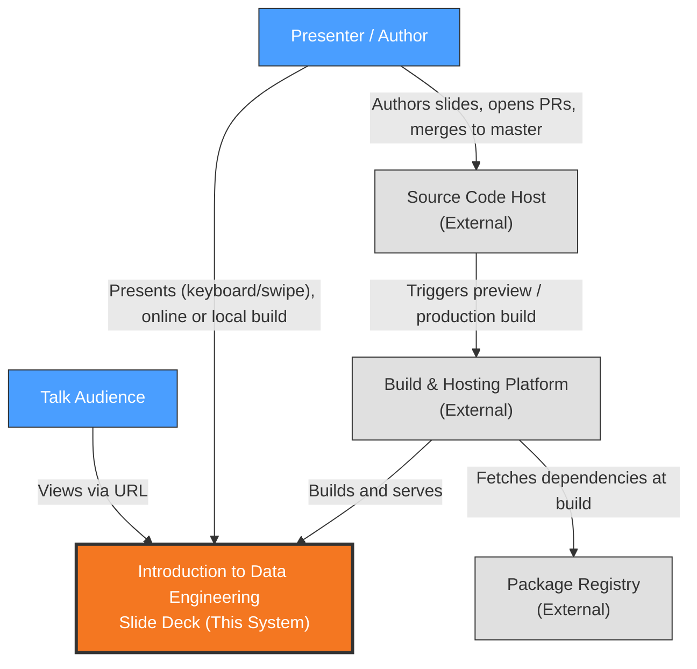

# Context View: System

**Sub-System**: System
**ADRs Referenced**: ADR-002, ADR-004, ADR-007, ADR-008
**Generated**: 2026-10-26 (regenerated after the Gatsby → Astro migration)

---

## 3.1 Context View

**Purpose**: Define system scope and external interactions

### 3.1.1 System Scope

"Introduction to Data Engineering" is a browser-based slide deck for a technical talk. It turns
author-written Markdown slides into a statically generated website, built with Astro, that a
presenter navigates live and an audience can open by URL (ADR-002, ADR-007).

In scope: authoring slide content, building the static site, hosting it, and presenting it in
a browser, either from the public URL or from a local build when the venue has no network
(ADR-008). Out of scope: user accounts, data collection, server-side logic, any runtime back
end (ADR-007), and browser-side offline caching (ADR-008).

### 3.1.2 Stakeholders

| Stakeholder | Role | Key Concerns | Priority |
|-------------|------|--------------|----------|
| Presenter / Author (repository owner) | Writes slides, delivers the talk, maintains the code | Easy Markdown authoring, reliable live navigation, a fallback when the venue network fails | High |
| Talk Audience | Views the deck live or via shared URL | Readable slides, fast loading on any device, touch navigation, shared links that keep working | High |
| Tikal (sponsoring organisation) | Brand shown in footer and metadata | Correct branding, professional presentation | Medium |
| Maintainer (future self / contributors) | Upgrades dependencies, fixes builds | Small upgrade surface, green builds, config in the repo, known security posture | Medium |

**Definition**: Stakeholders are HUMAN actors who interact with or have interest in the system. This includes end users, administrators, operators, and business owners. For automated/external systems, see 3.1.3 External Entities.

### 3.1.3 External Entities

| Entity | Type | Interaction Type | Data Exchanged | Protocols |
|--------|------|------------------|----------------|-----------|
| Source Code Host (GitHub) | External System | Git push; PRs trigger deploy previews, `master` triggers production builds | Repository contents (Markdown, code, assets, Netlify config) | SSH/HTTPS (git) |
| Build & Hosting Platform (Netlify) | External System | Builds from committed `netlify.toml`, serves via CDN with committed headers and redirects (ADR-004) | Built HTML/JS/CSS/images, response headers | HTTPS |
| Web Browser | External System (user agent) | Renders pages, runs navigation script; no service worker (ADR-008) | Static pages and assets | HTTPS |
| Package Registry (npm) | External System | Build-time dependency download | JavaScript packages (`astro` and dev tooling) | HTTPS |

### 3.1.4 Context Diagram

### 3.1.5 External Dependencies

| Dependency | Purpose | SLA Expectations | Fallback Strategy |
|------------|---------|------------------|-------------------|
| Netlify | Build + CDN hosting, headers, redirects (ADR-004) | Provider default; no contract | Local build: `yarn build && yarn serve` on the presenter's laptop (ADR-008); config is in the repo, so re-hosting is possible |
| GitHub | Source of truth, preview and production build trigger | Provider default | Local clone; manual deploy |
| npm registry | Build-time packages | Best effort | `yarn.lock` pins versions; retry build |

---

## Perspective Considerations

### Security Considerations

- The only trust boundary crossed at runtime is public HTTPS from browser to CDN. Fonts and
  images are self-hosted, so there are no third-party runtime requests. No authentication,
  user data or secrets (ADR-007).
- Content is author-controlled and rendered at build time by the Markdown pipeline (ADR-003).
- Security headers (CSP, Permissions-Policy, nosniff, X-Frame-Options, Referrer-Policy,
  X-XSS-Protection) are committed in `public/_headers` (ADR-004).
- Supply-chain exposure is now small: one runtime dependency (`astro`), pinned by `yarn.lock`
  (ADR-007).

_Source ADRs: ADR-003, ADR-004, ADR-007_

### Performance Considerations

- Pages are pre-rendered and served from the CDN edge, with no server latency (ADR-004,
  ADR-007).
- Images are optimised WebP with a responsive `srcset`; hashed assets are cached as immutable
  (ADR-007).

_Source ADRs: ADR-004, ADR-007_

### Evolution Considerations

- Build, header and redirect configuration live in the repo (`netlify.toml`, `public/`), so
  changing hosts means porting committed files (ADR-004).
- Future upgrades track the current Astro major, with the Node pin moving with it (ADR-007).
- `public/sw.js` must stay deployed while old browsers may still hold the Gatsby worker
  (ADR-008).

_Source ADRs: ADR-004, ADR-007, ADR-008_

---

**Validation Checklist**:

- [x] System appears as exactly ONE node
- [x] No internal databases shown
- [x] No internal services shown
- [x] All entities are either stakeholders OR external systems
- [x] All connections cross the system boundary (author → GitHub → Netlify pipeline shown as external chain)
- [x] Mermaid only
