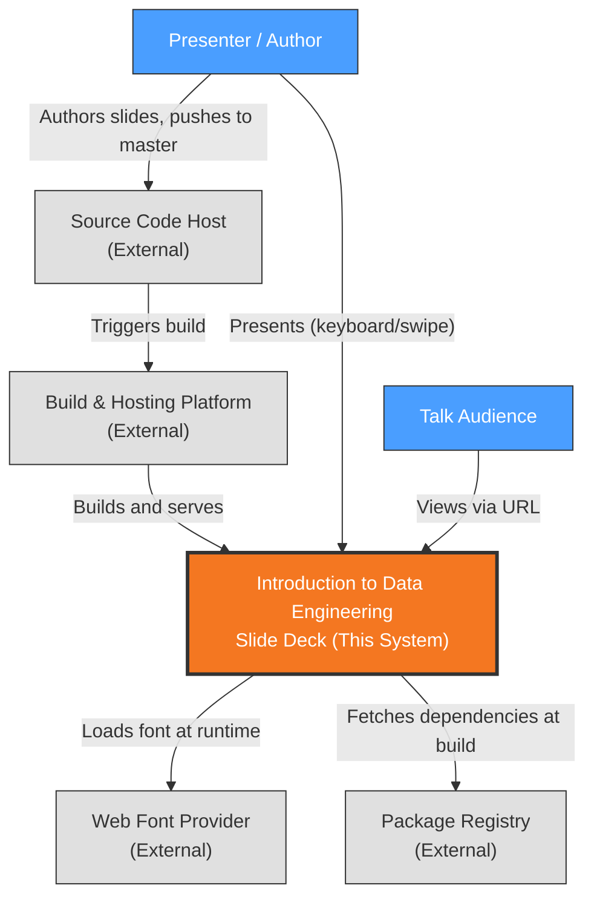

# Context View: System

**Sub-System**: System
**ADRs Referenced**: ADR-001, ADR-002, ADR-004, ADR-005
**Generated**: 2026-10-26

---

## 3.1 Context View

**Purpose**: Define system scope and external interactions

### 3.1.1 System Scope

"Introduction to Data Engineering" is a browser-based slide deck for a technical talk. It turns
author-written Markdown slides into a statically generated, offline-capable website that a
presenter navigates live and an audience can open by URL (ADR-001, ADR-002, ADR-005).

In scope: authoring slide content, building the static site, hosting it, and presenting it in
a browser. Out of scope: user accounts, data collection, server-side logic, and any runtime
back end (ADR-001).

### 3.1.2 Stakeholders

| Stakeholder | Role | Key Concerns | Priority |
|-------------|------|--------------|----------|
| Presenter / Author (repository owner) | Writes slides, delivers the talk, maintains the code | Easy Markdown authoring, reliable live navigation, deck works without venue network | High |
| Talk Audience | Views the deck live or via shared URL | Readable slides, fast loading on any device, touch navigation | High |
| Tikal (sponsoring organisation) | Brand shown in footer and metadata | Correct branding, professional presentation | Medium |
| Maintainer (future self / contributors) | Upgrades dependencies, fixes builds | Upgradable stack, green builds, known security posture | Medium |

**Definition**: Stakeholders are HUMAN actors who interact with or have interest in the system. This includes end users, administrators, operators, and business owners. For automated/external systems, see 3.1.3 External Entities.

### 3.1.3 External Entities

| Entity | Type | Interaction Type | Data Exchanged | Protocols |
|--------|------|------------------|----------------|-----------|
| Source Code Host (GitHub) | External System | Git push; triggers platform build | Repository contents (Markdown, code, assets) | SSH/HTTPS (git) |
| Static Hosting & Build Platform (Netlify) | External System | Pulls `master`, builds, serves via CDN | Built HTML/JS/CSS/images | HTTPS |
| Web Browser | External System (user agent) | Renders pages, runs service worker | Static pages, cached assets | HTTPS |
| Web Font Provider (Google Fonts) | External System | Browser fetches stylesheet/font at runtime | Quicksand font CSS + font files | HTTPS |
| Package Registry (npm) | External System | Build-time dependency download | JavaScript packages | HTTPS |

### 3.1.4 Context Diagram

### 3.1.5 External Dependencies

| Dependency | Purpose | SLA Expectations | Fallback Strategy |
|------------|---------|------------------|-------------------|
| Netlify | Build + CDN hosting (ADR-004) | Provider default; no contract | Service worker serves previously cached deck offline (ADR-005); local `gatsby build` + `gatsby serve` |
| GitHub | Source of truth, build trigger | Provider default | Local clone; manual deploy |
| Google Fonts | Quicksand typeface | Best effort | Browser falls back to system font (not cached offline — ADR-005 follow-up) |
| npm registry | Build-time packages | Best effort | `yarn.lock` pins versions; retry build |

---

## Perspective Considerations

### Security Considerations

- Only trust boundary crossed at runtime is public HTTPS from browser to CDN and font provider;
  no authentication, no user data, no secrets in the deck (ADR-001).
- Content is author-controlled and built at compile time, which is what makes raw HTML
  injection of slides acceptable (ADR-003).
- Supply-chain exposure is the main risk: build pulls from the npm registry; mitigated by
  lockfile and explicit security pins (ADR-006).

_Source ADRs: ADR-001, ADR-003, ADR-006_

### Performance Considerations

- Pages are pre-rendered and served from CDN edge; no server latency (ADR-001, ADR-004).
- Third-party font request is the only runtime external call on the critical render path.

_Source ADRs: ADR-001, ADR-004, ADR-005_

### Evolution Considerations

- Build and hosting configuration lives in the Netlify UI, outside version control; changing
  hosts requires re-creating it (ADR-004).
- Dependency on the Gatsby/npm ecosystem shapes all future upgrades (ADR-006).

_Source ADRs: ADR-004, ADR-006_

---

**Validation Checklist**:

- [x] System appears as exactly ONE node
- [x] No internal databases shown
- [x] No internal services shown
- [x] All entities are either stakeholders OR external systems
- [x] All connections cross the system boundary (author → GitHub → Netlify pipeline shown as external chain)
- [x] Mermaid only
