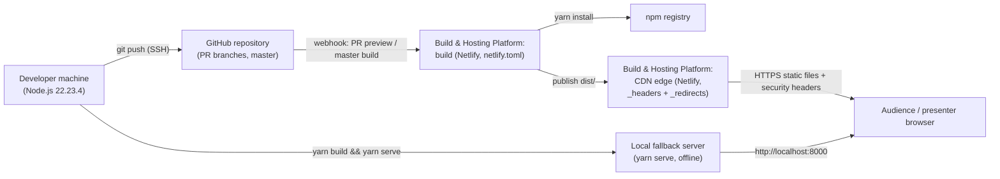

# Deployment View: System

**Sub-System**: System
**ADRs Referenced**: ADR-004, ADR-007, ADR-008
**Generated**: 2026-10-26 (regenerated after the Gatsby → Astro migration)
**Dependencies**: Development View

---

## 3.6 Deployment View

**Purpose**: Describe the physical environments where the system is built and runs

### 3.6.1 Runtime Environments

| Environment | Purpose | Infrastructure | Scale |
|-------------|---------|----------------|-------|
| Production | Public deck for talks and sharing | Netlify build + global CDN (site `hardcore-galileo-55838f`), deployed from `master` | Managed static hosting; no instances to size |
| Deploy Previews | Per-PR verification before merge (required by Constitution §III) | Netlify, `deploy-preview-<PR>--hardcore-galileo-55838f.netlify.app`, same committed config | Ephemeral |
| Local Development | Authoring and visual review | Developer machine: `yarn develop` on http://localhost:8000 (live reload) | 1 process |
| Local Production Check | Pre-commit build verification | Developer machine: `yarn build` + `yarn serve` | 1 process |
| Venue Fallback | Presenting without network (ADR-008) | Presenter's laptop: pre-built `dist/` served by `yarn serve` | 1 process + 1 browser |
| Presentation Device | Live delivery | Presenter's browser on the public URL or the local fallback; no service worker | 1 browser |

### 3.6.2 Network Topology

### 3.6.3 Hardware Requirements

| Component | CPU | Memory | Storage |
|-----------|-----|--------|---------|
| Build (local or Netlify runner) | Standard runner sufficient; image optimisation is the heaviest step (~2 s total locally) | Node default heap adequate for 40 slides | `node_modules` + `dist/` output (a few MB) |
| Hosting | Managed by Netlify | Managed | Static output only |
| Client | Any modern browser (View Transitions where supported, simulated fallback elsewhere) | Minimal | None used by the deck; returning browsers have their legacy cache deleted |

### 3.6.4 Third-Party Services

| Service | Purpose | Provider | Tier |
|---------|---------|----------|------|
| Static hosting, CDN, builds, deploy previews | Production site and PR previews | Netlify | Not recorded in repo (account setting) |
| Source hosting, build trigger | Repository `sshahar1/introduction-to-data-engineering` | GitHub | Not recorded |
| Package registry | Build-time dependencies | npm | Public |

---

## Perspective Considerations

### Security Considerations

- Public, unauthenticated, read-only site over HTTPS; no server-side attack surface.
- Response headers from `public/_headers`: same-origin `Content-Security-Policy` (12
  directives), deny-all `Permissions-Policy`, `X-Content-Type-Options: nosniff`,
  `X-Frame-Options: DENY`, `Referrer-Policy: same-origin`, `X-XSS-Protection`; HSTS added by
  Netlify. Verified identical to the Gatsby production baseline on the PR #131 preview
  (ADR-004).
- Deploy authority = merge access to `master` on GitHub plus Netlify account access; protect
  both (ADR-004).
- The build runner executes npm install scripts; exposure is limited to one runtime
  dependency and the lockfile (ADR-007).

_Source ADRs: ADR-004, ADR-007_

### Performance Considerations

- Static files from the CDN edge; latency is bound by network, not compute.
- Hashed `/_astro/*` assets are served with `Cache-Control: immutable`; HTML revalidates on
  every visit, so deploys take effect immediately (ADR-004, ADR-008).
- The Quicksand font (400 weight, about 31 KB of woff2) is self-hosted under `/_astro/`
  (ADR-007).

_Source ADRs: ADR-004, ADR-007, ADR-008_

### Evolution Considerations

- Build settings (command, publish dir, Node version) are committed in `netlify.toml`, so
  re-hosting or recovering the site no longer depends on dashboard state (ADR-004).
- The Node pin must move with Astro's minimum on each major upgrade; the first preview of the
  migration failed exactly on this (ADR-007).
- `/sw.js` is served with `Cache-Control: no-cache` so the kill switch reaches returning
  browsers promptly (ADR-008).

_Source ADRs: ADR-004, ADR-007, ADR-008_

---

## Validation Checklist

- [x] All environments listed
- [x] Topology in Mermaid
- [x] Third-party services identified
- [x] No operational/concurrency content (core views only)

---

**ADR Traceability:**

| ADR | Decision | Impact on Deployment View |
|-----|----------|---------------------------|
| ADR-004 | Netlify with committed config, preview gate | Production + preview environments, headers, redirects |
| ADR-007 | Astro static site | Build environment (Node 22.23.4), `dist/` output |
| ADR-008 | No offline worker; local fallback | Removes the browser cache tier; adds the Venue Fallback environment |
