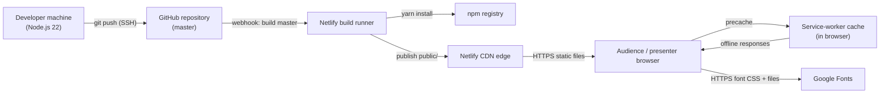

# Deployment View: System

**Sub-System**: System
**ADRs Referenced**: ADR-001, ADR-004, ADR-005, ADR-006
**Generated**: 2026-10-26
**Dependencies**: Development View

---

## 3.6 Deployment View

**Purpose**: Describe the physical environments where the system is built and runs

### 3.6.1 Runtime Environments

| Environment | Purpose | Infrastructure | Scale |
|-------------|---------|----------------|-------|
| Production | Public deck for talks and sharing | Netlify build + global CDN (site `hardcore-galileo-55838f`), deployed from `master` | Managed static hosting; no instances to size |
| Deploy Previews | Optional per-branch/PR preview | Netlify (platform feature, if enabled in UI) | Ephemeral |
| Local Development | Authoring and visual review | Developer machine: `gatsby develop` on http://localhost:8000 | 1 process |
| Local Production Check | Pre-commit build verification | Developer machine: `gatsby build` + `gatsby serve` | 1 process |
| Presentation Device | Live delivery | Presenter's browser, possibly offline via service-worker cache | 1 browser |

### 3.6.2 Network Topology

### 3.6.3 Hardware Requirements

| Component | CPU | Memory | Storage |
|-----------|-----|--------|---------|
| Build (local or Netlify runner) | Standard runner sufficient; sharp image processing is the heaviest step | Node default heap adequate for ~45 slides | `node_modules` + `public/` output (tens of MB) |
| Hosting | Managed by Netlify | Managed | Static output only |
| Client | Any modern browser | Minimal | Service-worker cache for pages + images |

### 3.6.4 Third-Party Services

| Service | Purpose | Provider | Tier |
|---------|---------|----------|------|
| Static hosting, CDN, builds | Production site | Netlify | Not recorded in repo (UI setting) |
| Source hosting, build trigger | Repository `sshahar1/introduction-to-data-engineering` | GitHub | Not recorded |
| Web fonts | Quicksand typeface | Google Fonts | Free |
| Package registry | Build-time dependencies | npm | Public |

---

## Perspective Considerations

### Security Considerations

- Public, unauthenticated, read-only site over HTTPS; no server-side attack surface.
- Deploy authority = push access to `master` on GitHub plus Netlify account access; protect
  both (ADR-004).
- Build runner executes npm install scripts — supply-chain exposure addressed by lockfile and
  security pins (ADR-006).

_Source ADRs: ADR-004, ADR-006_

### Performance Considerations

- Static files from CDN edge; latency bound by network, not compute.
- Repeat and offline visits served from service-worker cache (ADR-005).
- Google Fonts is a cross-origin request on first paint; self-hosting would remove it.

_Source ADRs: ADR-001, ADR-005_

### Evolution Considerations

- Build settings (Node version, command, publish dir) live only in the Netlify UI; moving
  hosts or recovering a lost site requires re-creating them. A committed `netlify.toml` would
  capture them (ADR-004).
- `engines.node >= 22` must match the Netlify runner's Node version on each upgrade (ADR-006).

_Source ADRs: ADR-004, ADR-006_

---

## Validation Checklist

- [x] All environments listed
- [x] Topology in Mermaid
- [x] Third-party services identified
- [x] No operational/concurrency content (core views only)

---

**ADR Traceability:**

| ADR | Decision | Impact on Deployment View |
|-----|----------|---------------------------|
| ADR-001 | Static site | No servers or databases to deploy |
| ADR-004 | Netlify from master, UI settings | Defines production environment and pipeline |
| ADR-005 | Offline PWA | Browser cache as runtime tier |
| ADR-006 | Node 22, pins | Build environment requirements |
