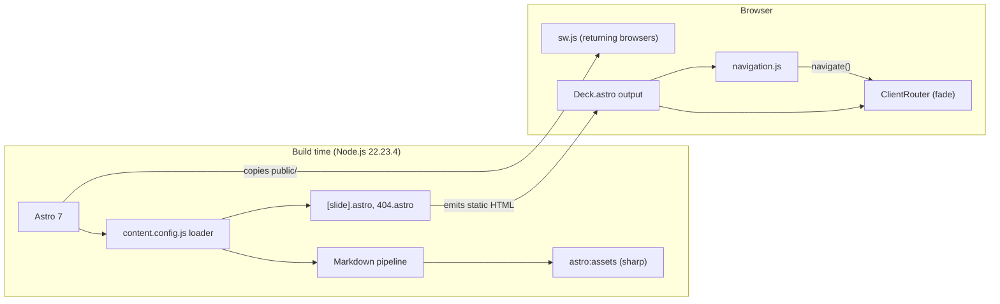

# Development View: System

**Sub-System**: System
**ADRs Referenced**: ADR-002, ADR-003, ADR-004, ADR-007, ADR-008
**Generated**: 2026-10-26 (regenerated after the Gatsby → Astro migration)
**Dependencies**: Functional View

---

## 3.5 Development View

**Purpose**: Describe code organisation, technology mapping, and build process

### 3.5.1 Code Organization

```text
introduction-to-data-engineering/
├── astro.config.mjs        # URLs (/N, no trailing slash), image + Markdown options, dev redirect
├── netlify.toml            # Build command, publish dir, NODE_VERSION
├── package.json / yarn.lock
├── .tool-versions          # nodejs 22.23.4, yarn 1.22.22
├── .husky/pre-commit       # Runs Prettier on src/**/*.{js,astro} and *.mjs
├── .prettierrc             # + prettier-plugin-astro
├── public/                 # Copied to dist/ unchanged
│   ├── _headers            # CSP + security headers, cache rules
│   ├── _redirects          # / -> /1 (302, forced)
│   └── sw.js               # Legacy Worker Retirement (kill switch)
└── src/
    ├── content.config.js   # Slide Sequencer + Content Renderer (custom loader)
    ├── site.js             # Site Metadata
    ├── slides/             # Slide Content Store: NN-topic[suffix].md (40 files)
    ├── resources/          # Images, logo, self-hosted fonts
    ├── layouts/Deck.astro  # Presentation Shell + Transition Animator wiring
    ├── layouts/index.css   # Deck styling (unchanged from Gatsby, plus image sizing rule)
    ├── scripts/navigation.js  # Navigation Controller
    └── pages/              # [slide].astro (Page Generator), 404.astro
```

### 3.5.2 Technology Stack Mapping

| Functional Role | Technology Choice | Version/Variant | ADR Reference |
|-----------------|-------------------|-----------------|---------------|
| Static site generator | Astro, static output, no adapter | ^7.4.2 | ADR-007 |
| Slide Content Store + Slide Sequencer | Astro content collection with custom loader (`src/content.config.js`) | — | ADR-002, ADR-007 |
| Content Renderer | Astro Markdown pipeline (`renderMarkdown`), smartypants off, syntax highlighting off | built in | ADR-007 |
| Image Processor | `astro:assets` (sharp), constrained layout, breakpoints ≤ 1920px | built in | ADR-007 |
| Page Generator | `src/pages/[slide].astro` (`getStaticPaths`), `404.astro`, `public/_redirects`, `public/_headers` | — | ADR-002, ADR-004 |
| Presentation Shell | `src/layouts/Deck.astro` | — | ADR-003 |
| Navigation Controller | Plain JavaScript module (`src/scripts/navigation.js`) | — | ADR-003 |
| Transition Animator | `astro:transitions` (`ClientRouter`, `fade` 0.2s) | built in | ADR-003, ADR-007 |
| Legacy Worker Retirement | Static `public/sw.js` | — | ADR-008 |
| Formatting | Prettier + prettier-plugin-astro + Husky | ^3.3.3 / ^1.1.2 / ^9.1.6 | ADR-007 |
| Linting (unconfigured) | ESLint 9, @typescript-eslint 4, babel-eslint 10 | no config file | ADR-007 |
| Runtime | Node.js | 22.23.4 (pinned; Astro 7.4 minimum) | ADR-004, ADR-007 |

### 3.5.3 Technology Architecture



### 3.5.4 Module Dependencies

| Module | Depends On | Notes |
|--------|------------|-------|
| `src/content.config.js` | `src/slides/*.md`, Astro loader context (`renderMarkdown`, `store`) | Sorts, splits source at breaks, registers image imports (`assetImports`), live reload in dev |
| `src/pages/[slide].astro` | `slides` collection, `Deck.astro` | One page per entry; passes `index` and `total` |
| `src/layouts/Deck.astro` | `site.js`, `logo.png`, `index.css`, `astro:transitions`, `navigation.js` | Title, footer, `#slide` data attributes, transitions |
| `src/scripts/navigation.js` | `astro:transitions/client` (`navigate`) | Reads index/total from the DOM at event time |
| `src/pages/404.astro` | `Deck.astro` | No index → no footer number, navigation inactive |

### 3.5.5 Build & CI/CD

| Stage | Where | Command / Mechanism | Gate |
|-------|-------|---------------------|------|
| Format | Local, pre-commit | Husky → `npm run format` (Prettier on `src/**/*.{js,astro}`, `*.mjs`) | Blocks commit on failure |
| Local build check | Local | `yarn build` (Constitution §III) | Required before commit |
| Preview | Local | `yarn develop` (live reload) / `yarn serve` (production build) | Manual visual review |
| Deploy preview | Netlify, on PR | `netlify.toml`: `yarn build`, publish `dist/`, `NODE_VERSION` | Required green before merge (Constitution §III) |
| CI | None in repository | — | — |
| Build + deploy | Netlify, on merge to `master` | Same committed config | Deploy fails if build fails |

### 3.5.6 Development Standards

- Slide naming and Markdown-first rules: Constitution §I, §II
- Green build before commit, green preview before merge: Constitution §III
- Local optimised assets in `src/resources/`, widths ≤ 1920px: Constitution §IV
- Dependency justification, no client UI framework: Constitution §V
- `yarn.lock` is the only lockfile; `CLAUDE.md` describes the same commands (updated
  2026-10-26)

---

## Perspective Considerations

### Security Considerations

- Supply chain reduced to one runtime dependency; `yarn audit` reports 0 vulnerabilities
  (2026-10-26). The Gatsby-era transitive security pins are gone (ADR-007).
- No secrets in repository or build; nothing to rotate.

_Source ADRs: ADR-007_

### Performance Considerations

- Builds take about 2 s locally including image optimisation (41 pages); dev reloads slide
  edits live (ADR-007).

_Source ADRs: ADR-007_

### Evolution Considerations

- The custom loader depends on Astro's content-loader API; regressions are caught by the slide
  text comparison and the split test (ADR-002, ADR-007).
- Astro majors raise the Node minimum; the pin lives in `.tool-versions`, `netlify.toml` and
  `package.json` (ADR-007).
- The lint toolchain is still installed but non-functional; configure or remove it (ADR-007).
- `public/sw.js` stays until a new ADR retires it (ADR-008).

_Source ADRs: ADR-002, ADR-007, ADR-008_

---

## Validation Checklist

- [x] Code organisation matches repository
- [x] Every Functional element mapped to a technology
- [x] Build pipeline stages and gates listed
- [x] Mermaid used for architecture diagram (directory tree in `text` block)

---

**ADR Traceability:**

| ADR | Decision | Impact on Development View |
|-----|----------|----------------------------|
| ADR-002 | Markdown content model | `src/slides/` + loader split rules |
| ADR-003 | In-house runtime | `Deck.astro`, `navigation.js`, `ClientRouter` |
| ADR-004 | Netlify with committed config | `netlify.toml`, `public/_headers`, `public/_redirects`; preview gate |
| ADR-007 | Astro static site | Toolchain, repo layout, Node pin, Prettier plugin |
| ADR-008 | No offline worker | `public/sw.js` kill switch only |
