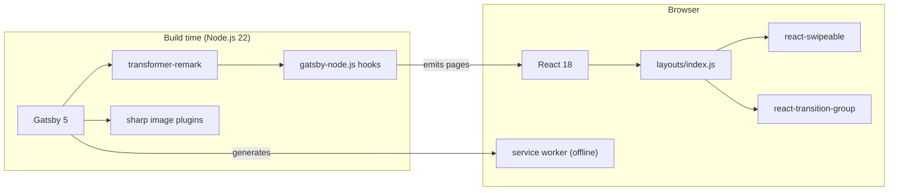

# Development View: System

**Sub-System**: System
**ADRs Referenced**: ADR-001, ADR-002, ADR-003, ADR-004, ADR-005, ADR-006
**Generated**: 2026-10-26
**Dependencies**: Functional View

---

## 3.5 Development View

**Purpose**: Describe code organisation, technology mapping, and build process

### 3.5.1 Code Organization

```text
introduction-to-data-engineering/
├── gatsby-config.js        # Plugins, content source, site metadata
├── gatsby-node.js          # Slide Sequencer + Page Generator (build hooks)
├── package.json / yarn.lock
├── .husky/pre-commit       # Runs Prettier on src/**/*.js
├── .prettierrc
└── src/
    ├── slides/             # Slide Content Store: NN-topic[NN].md (~45 files)
    ├── resources/          # Images (logo, diagrams, photos)
    ├── templates/slide.js  # Renders one slide's HTML
    ├── layouts/index.js    # Presentation Shell + Navigation Controller
    ├── layouts/index.css   # Deck styling
    ├── components/transition.js  # Transition Animator
    └── pages/              # index.js (redirect / → /1), 404.js
```

### 3.5.2 Technology Stack Mapping

| Functional Role | Technology Choice | Version/Variant | ADR Reference |
|-----------------|-------------------|-----------------|---------------|
| Static site generator / App shell | Gatsby | ^5.16.1 | ADR-001 |
| UI library | React / React DOM | ^18.1.0 | ADR-001 |
| Slide Content Store source | gatsby-source-filesystem | ^5.12.1 | ADR-002 |
| Content Transformer | gatsby-transformer-remark | 6.16.0 (exact pin) | ADR-002, ADR-006 |
| Image Processor | gatsby-remark-images, gatsby-plugin-sharp, gatsby-transformer-sharp | ^7.12 / ^5.16 | ADR-002 |
| Linked file copy | gatsby-remark-copy-linked-files | ^6.12.0 | ADR-002 |
| Presentation Shell layout | gatsby-plugin-layout, react-helmet | ^4.12 / ^6.1 | ADR-003 |
| Navigation Controller (touch) | react-swipeable | ^6.1.2 | ADR-003 |
| Transition Animator | react-transition-group | ^4.3.0 | ADR-003 |
| Offline Cache | gatsby-plugin-offline | ^6.16.0 | ADR-005 |
| Hosting adapter | gatsby-adapter-netlify | ^1.4.0 | ADR-004 |
| Security pins | tar-fs, cookie, @expo/devcert | ^3.1.1 / ^0.7.2 / ^1.2.1 | ADR-006 |
| Formatting | Prettier + Husky | ^3.3.3 / ^9.1.6 | ADR-006 |
| Linting (unconfigured) | ESLint 9, @typescript-eslint 4, babel-eslint 10 | no config file | ADR-006 |
| Runtime | Node.js | >= 22 | ADR-006 |

### 3.5.3 Technology Architecture



### 3.5.4 Module Dependencies

| Module | Depends On | Notes |
|--------|------------|-------|
| `gatsby-node.js` | Remark nodes (GraphQL), `src/templates/slide.js` | Sorts, splits on `<hr>`, creates `Slide` type and pages |
| `src/templates/slide.js` | `Slide` GraphQL type | Injects HTML via `dangerouslySetInnerHTML` |
| `src/layouts/index.js` | `site.siteMetadata`, `allSlide` count, transition, swipeable, logo | Global keydown listener |
| `src/components/transition.js` | react-transition-group | Keyed on `location.pathname` |
| `src/pages/index.js` | Gatsby `navigate` | Redirects to `/1` |

### 3.5.5 Build & CI/CD

| Stage | Where | Command / Mechanism | Gate |
|-------|-------|---------------------|------|
| Format | Local, pre-commit | Husky → `npm run format` (Prettier on `src/**/*.js`) | Blocks commit on failure |
| Local build check | Local | `gatsby build` (Constitution §III) | Manual, required before commit |
| Preview | Local | `gatsby develop` / `gatsby serve` | Manual visual review |
| CI | None in repository | — | — |
| Build + deploy | Netlify, on push to `master` | `gatsby build`, settings in Netlify UI | Deploy fails if build fails |

### 3.5.6 Development Standards

- Slide naming and Markdown-first rules: Constitution §I, §II
- Green build before commit: Constitution §III
- Local optimised assets: Constitution §IV
- Dependency justification: Constitution §V
- `yarn.lock` is the authoritative lockfile (Constitution, Technology section); `CLAUDE.md`
  uses the same yarn commands (aligned 2026-10-26)

---

## Perspective Considerations

### Security Considerations

- Supply chain: transitive vulnerabilities fixed by promoting `tar-fs`, `cookie`,
  `@expo/devcert` to direct dependencies; review on every upgrade (ADR-006).
- No secrets in repository or build; nothing to rotate.

_Source ADRs: ADR-006_

### Performance Considerations

- Build cost dominated by sharp image processing; acceptable for current asset count.

_Source ADRs: ADR-003_

### Evolution Considerations

- Upgrade blockers: deprecated `keyCode` (ADR-003); exact remark pin (ADR-006).
  highlight.js was removed on 2026-10-26.
- Lint toolchain is installed but non-functional (no `eslint.config.*`, plugin majors mismatch
  ESLint 9) — either configure or remove (ADR-006).
- Build config not in repo; committing `netlify.toml` would make builds reproducible (ADR-004).

_Source ADRs: ADR-003, ADR-004, ADR-006_

---

## Validation Checklist

- [x] Code organisation matches repository
- [x] Every Functional element mapped to a technology
- [x] Build pipeline stages and gates listed
- [x] Mermaid used for architecture diagram (directory tree in `text` block)

---

**ADR Traceability:**

| ADR | Decision | Impact on Development View |
|-----|----------|----------------------------|
| ADR-001 | Gatsby static site | Defines toolchain and repo layout |
| ADR-002 | Markdown content model | `src/slides/` + `gatsby-node.js` logic |
| ADR-003 | In-house runtime | `layouts/`, `components/`, `templates/` modules |
| ADR-004 | Netlify, no repo CI | Build pipeline lives on platform |
| ADR-005 | Offline PWA | `gatsby-plugin-offline` |
| ADR-006 | Incremental upgrades | Pins, lint mismatch, Node 22 engine |
