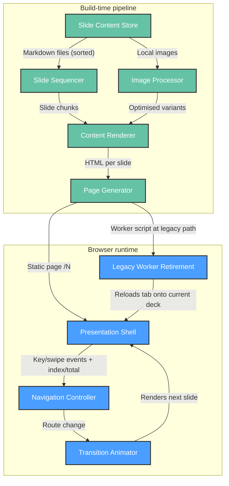

# Functional View: System

**Sub-System**: System
**ADRs Referenced**: ADR-002, ADR-003, ADR-007, ADR-008
**Generated**: 2026-10-26 (regenerated after the Gatsby → Astro migration)
**Dependencies**: Context View

---

## 3.2 Functional View

**Purpose**: Describe functional elements, their responsibilities, and interactions

> **Technology Abstraction Rule**: Elements are described by architectural role. Concrete
> technologies are mapped in the Development View (§3.5).

The system is a single deployable static site (ADR-007) with two lifecycle stages: a
**build-time pipeline** that turns Markdown into slide pages, and a **browser runtime** that
presents them. A separate **legacy-worker retirement** element exists only to move browsers
off the previous Gatsby deployment (ADR-008).

### 3.2.1 Functional Elements

| Element | Stage | Responsibility | Interfaces Provided | Dependencies |
|---------|-------|----------------|---------------------|--------------|
| Slide Content Store | Build | Holds slide source as Markdown files ordered by name; images and fonts in a separate assets directory (ADR-002) | Files in content and assets directories | — |
| Slide Sequencer | Build | Sorts files by path, splits each file's Markdown source at thematic breaks (not after a heading line, not inside code fences), numbers slides globally (ADR-002) | Ordered slide records (index, title, source chunk) | Slide Content Store |
| Content Renderer | Build | Renders each slide chunk to HTML, keeping punctuation as written and code blocks unhighlighted; resolves image references (ADR-007) | HTML per slide | Slide Sequencer, Image Processor |
| Image Processor | Build | Generates optimised responsive image variants, no wider than 1920px (ADR-007) | Optimised image assets | Slide Content Store |
| Page Generator | Build | Emits one static page per slide at `/N` with no trailing slash, plus a NOT FOUND page; declares the `/` → `/1` redirect and response headers (ADR-002, ADR-004) | Static routes `/1..N`, 404, redirect and header rules | Content Renderer |
| Presentation Shell | Runtime | Wraps every slide: document title, footer (logo, deck title, slide number); exposes current index and total to the page (ADR-003) | Layout around current slide | Page Generator output |
| Navigation Controller | Runtime | Maps keys (Right/Enter/Space, Left) and swipes to next/previous slide; bounded at first/last; inactive on the NOT FOUND page (ADR-003) | Client-side route change to `/N±1` | Presentation Shell |
| Transition Animator | Runtime | Cross-fades the slide area for 200 ms on route change; footer swaps without animation (ADR-003) | Animated slide container | Navigation Controller |
| Legacy Worker Retirement | Runtime (returning browsers only) | Clears the old Gatsby offline caches, unregisters the old worker, reloads open tabs; nothing registers a worker anymore (ADR-008) | Worker script at the legacy path | Page Generator output (static file) |

### 3.2.2 Element Interactions

### 3.2.3 Functional Boundaries

**What this system DOES:**

- Turns ordered Markdown files into numbered, deep-linkable slide pages
- Presents slides with keyboard and touch navigation and fade transitions
- Moves returning browsers off the old offline-cached deck automatically
- Runs fully offline from a local build on the presenter's machine

**What this system does NOT do:**

- No user accounts, authentication, analytics, or data collection
- No server-side logic or runtime API
- No browser-side offline caching of the public URL (ADR-008)
- No presenter tooling: speaker notes, overview grid, presenter/audience split, PDF export
- No stable slugs: slide URLs are positional and shift on insertion (accepted, ADR-002)

---

## Perspective Considerations

### Security Considerations

- Slide HTML is produced at build time from author-controlled Markdown; there is no runtime
  HTML injection of untrusted content (ADR-003, ADR-007).
- No authorisation model needed: all content is public.
- The retirement worker has no fetch handler, so it cannot intercept requests; it only deletes
  caches and unregisters itself (ADR-008).

_Source ADRs: ADR-003, ADR-007, ADR-008_

### Performance Considerations

- All transformation cost sits at build time; runtime work is a client-side route change and a
  200 ms fade (ADR-003).
- Images are served as size-appropriate WebP variants (ADR-007).

_Source ADRs: ADR-003, ADR-007_

### Evolution Considerations

- The Slide Sequencer splits the Markdown source by rule, so it no longer depends on how the
  renderer serialises separators (ADR-002).
- The Navigation Controller reads the current position from the page on each event, so it
  keeps working across client-side page swaps (ADR-003).
- The extension point for new slides is purely additive: add a correctly named file (ADR-002).
- Legacy Worker Retirement is transitional, and can be removed only by a new ADR (ADR-008).

_Source ADRs: ADR-002, ADR-003, ADR-007, ADR-008_

---

## Validation Checklist

- [x] Technology Neutrality: elements named by role
- [x] Diagram Consistency: node labels match element table
- [x] Interface Abstraction: interfaces described as capabilities
- [x] Complete Coverage: build pipeline + runtime responsibilities represented
- [x] Clear Boundaries: DOES / does NOT do stated

---

**ADR Traceability:**

| ADR | Decision | Impact on Functional View |
|-----|----------|---------------------------|
| ADR-002 | Markdown split into slides, path-ordered | Defines Content Store, Slide Sequencer, Page Generator routes |
| ADR-003 | In-house presentation runtime | Defines Shell, Navigation, Transition elements |
| ADR-004 | Netlify with committed config | Page Generator declares redirect and header rules |
| ADR-007 | Astro static site | Build pipeline + browser runtime; Content Renderer and Image Processor behaviour |
| ADR-008 | No offline worker; local fallback | Removes Offline Cache; adds Legacy Worker Retirement |
