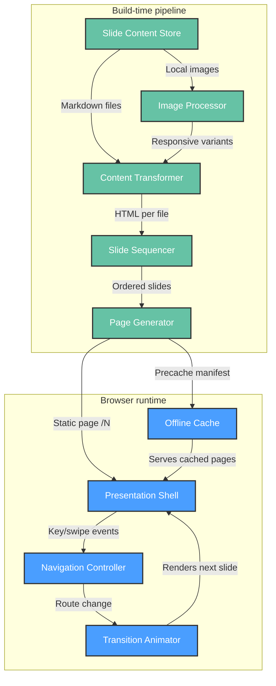

# Functional View: System

**Sub-System**: System
**ADRs Referenced**: ADR-001, ADR-002, ADR-003, ADR-005
**Generated**: 2026-10-26
**Dependencies**: Context View

---

## 3.2 Functional View

**Purpose**: Describe functional elements, their responsibilities, and interactions

> **Technology Abstraction Rule**: Elements are described by architectural role. Concrete
> technologies are mapped in the Development View (§3.5).

The system is a single deployable static site (ADR-001) with two lifecycle stages: a
**build-time pipeline** that turns Markdown into slide pages, and a **browser runtime** that
presents them.

### 3.2.1 Functional Elements

| Element | Stage | Responsibility | Interfaces Provided | Dependencies |
|---------|-------|----------------|---------------------|--------------|
| Slide Content Store | Build | Holds slide source as ordered Markdown files plus local images (ADR-002) | Files in content directory, ordered by name | — |
| Content Transformer | Build | Parses Markdown to HTML; processes and resizes images | HTML fragments per file | Slide Content Store, Image Processor |
| Image Processor | Build | Generates responsive image variants (max width 1920px) | Optimised image assets | Slide Content Store |
| Slide Sequencer | Build | Sorts files by path, splits HTML on slide separators, numbers slides globally (ADR-002) | Ordered `Slide` records (index, html) | Content Transformer |
| Page Generator | Build | Emits one static page per slide at `/N`; redirects `/` → `/1`; normalises trailing slashes | Static routes `/1..N` | Slide Sequencer |
| Presentation Shell | Runtime | Wraps every slide: title, footer (logo, slide number), branding (ADR-003) | Layout around current slide | Page Generator output |
| Navigation Controller | Runtime | Maps keyboard (←, →, Enter, Space) and swipe gestures to previous/next slide routes; bounds at first/last (ADR-003) | Route change to `/N±1` | Presentation Shell, slide count |
| Transition Animator | Runtime | Fades between slides on route change (200 ms) (ADR-003) | Animated slide container | Navigation Controller |
| Offline Cache | Runtime | Service worker precaches pages/assets so the deck runs without network (ADR-005) | Cached responses | Page Generator output |

### 3.2.2 Element Interactions

### 3.2.3 Functional Boundaries

**What this system DOES:**

- Turns ordered Markdown files into numbered, deep-linkable slide pages
- Presents slides with keyboard and touch navigation and fade transitions
- Keeps working offline after first visit

**What this system does NOT do:**

- No user accounts, authentication, analytics, or data collection
- No server-side logic or runtime API
- No presenter tooling: speaker notes, overview grid, presenter/audience split, PDF export
- No stable slugs — slide URLs are positional and shift on insertion (accepted, ADR-002)

---

## Perspective Considerations

### Security Considerations

- Slide HTML is injected raw into the shell; safe only because the Content Store is
  author-controlled and processed at build time. Accepting external or user content would
  require sanitisation (ADR-003).
- No authorisation model needed: all content is public.

_Source ADRs: ADR-001, ADR-003_

### Performance Considerations

- All transformation cost sits at build time; runtime work is route change + fade.
- Offline Cache makes repeat navigation local after first load (ADR-005).

_Source ADRs: ADR-003, ADR-005_

### Evolution Considerations

- Slide Sequencer splits on the literal rendered separator string; a change in Markdown
  rendering would silently break slide boundaries (ADR-002).
- Navigation Controller uses a deprecated keyboard API (ADR-003).
- Extension point for new slides is purely additive: add a correctly named file (ADR-002).

_Source ADRs: ADR-002, ADR-003, ADR-006_

---

## Validation Checklist

- [x] Technology Neutrality: elements named by role
- [x] Diagram Consistency: node labels match element table
- [x] Interface Abstraction: interfaces described as capabilities
- [x] Complete Coverage: build pipeline + runtime responsibilities represented
- [x] Clear Boundaries: DOES / does NOT do stated

---

**ADR Traceability:**

| ADR | Decision | Impact on Functional View |
|-----|----------|---------------------------|
| ADR-001 | Static-site-generated deck | Splits system into build pipeline + browser runtime; no back end |
| ADR-002 | Markdown split on separator, path-ordered | Defines Content Store, Slide Sequencer, Page Generator |
| ADR-003 | In-house presentation runtime | Defines Shell, Navigation, Transition elements |
| ADR-005 | Offline PWA | Adds Offline Cache element |
