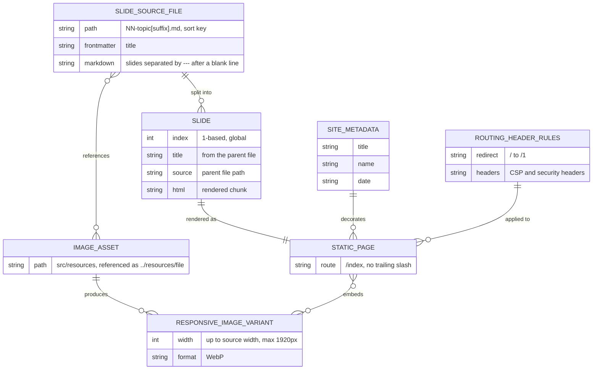

# Information View: System

**Sub-System**: System
**ADRs Referenced**: ADR-002, ADR-004, ADR-007, ADR-008
**Generated**: 2026-10-26 (regenerated after the Gatsby → Astro migration)
**Dependencies**: Context View, Functional View

---

## 3.3 Information View

**Purpose**: Describe how information is stored, transformed, and flows

The system has **no runtime data store and no user data** (ADR-007). All information is
authored content, transformed once at build time into immutable static artifacts. Since
ADR-008 there is no browser-side cache either; the only browser storage the system touches is
the *legacy* Gatsby cache, which it deletes.

### 3.3.1 Data Entities

| Entity | Storage Location | Owner Component | Lifecycle | Access Pattern |
|--------|------------------|-----------------|-----------|----------------|
| Slide Source File | Version-controlled content directory (`src/slides/`) | Slide Content Store | Authored → edited → committed | Read once per build; re-read live in dev |
| Image Asset | Version-controlled assets directory (`src/resources/`) | Slide Content Store | Added → committed; rarely changed | Read + optimised per build |
| Site Metadata | Build configuration module | Presentation Shell | Set at project setup; rarely changed | Read per build (title, presenter name, date) |
| Slide | Build-time content collection entry | Slide Sequencer | Derived each build; discarded after build | Looked up by index during page generation |
| Static Page | Hosted static output | Page Generator | Regenerated each deploy; immutable per deploy | Read-only HTTP GET `/N` |
| Responsive Image Variant | Hosted static output | Image Processor | Regenerated each deploy; content-hashed name | Read-only HTTP GET, cached as immutable |
| Routing & Header Rules | Version-controlled static files (`public/_redirects`, `public/_headers`) | Page Generator | Changed by commit only | Applied by the CDN to every response |
| Legacy Gatsby Cache | Browser Cache Storage (returning visitors only) | Legacy Worker Retirement | Created by the old deployment; deleted on first visit after migration | Delete-only |

### 3.3.2 Data Model

### 3.3.3 Data Flow

```mermaid
flowchart LR
    A["Slide Source Files<br/>+ Image Assets"] -->|"PR / merge"| B["Repository"]
    B -->|"preview or production build"| C["Sort by path,<br/>split source at breaks"]
    C -->|"render each chunk,<br/>optimise images"| D["Slides (index, title, html)"]
    D -->|"one page per slide"| E["Static Pages /1..N<br/>+ 404 + rules"]
    E -->|"CDN with headers"| F["Browser"]
    F -.->|"returning visitors:<br/>delete legacy cache"| G["Legacy Gatsby Cache"]
```

### 3.3.4 Data Quality & Integrity

- **Ordering integrity** depends on file-naming discipline; the build does not validate order
  (ADR-002).
- **Split integrity**: boundaries follow explicit source rules (a break after a blank line,
  outside code fences); empty chunks are kept so numbering stays stable (ADR-002).
- **Identity**: slides have no stable IDs. The index is positional, so inserting a slide
  renumbers all later routes; this is an accepted trade-off (ADR-002).
- **Freshness**: no browser cache serves stale slides; every visit gets the deployed version
  (ADR-008).
- **Integrity check used in migration**: slide text compared with the previous production
  deck on 40/40 slides (ADR-007).

---

## Perspective Considerations

### Security Considerations

- All information is public; no PII, credentials or secrets are stored or processed.
- Integrity relies on repository access control: whoever can merge to `master` can publish.
  Deploy previews make changes reviewable before that (ADR-004).

_Source ADRs: ADR-004, ADR-007_

### Performance Considerations

- Images are optimised at build time, so pages ship WebP variants sized for the viewport
  (ADR-007).
- Slide HTML is small (most source files < 500 bytes); no runtime querying.

_Source ADRs: ADR-002, ADR-007_

### Evolution Considerations

- Adding explicit ordering or stable slugs (e.g. frontmatter) would be a data-model change
  touching every source file; currently deferred (ADR-002).
- The Legacy Gatsby Cache entity disappears once no returning browser holds it (ADR-008).

_Source ADRs: ADR-002, ADR-008_

---

## Validation Checklist

- [x] ER diagram in Mermaid `erDiagram`
- [x] Data flow in Mermaid `flowchart`
- [x] Every entity owned by a Functional View element
- [x] Lifecycle stated for each entity

---

**ADR Traceability:**

| ADR | Decision | Impact on Information View |
|-----|----------|----------------------------|
| ADR-002 | Markdown split, positional index | Defines Slide entity, ordering, split and identity rules |
| ADR-004 | Netlify with committed config | Repository is the single source of truth, including routing and header rules |
| ADR-007 | Astro static site | No runtime store; content collection; optimised image variants |
| ADR-008 | No offline worker | Removes cached copies; Legacy Gatsby Cache is delete-only |
