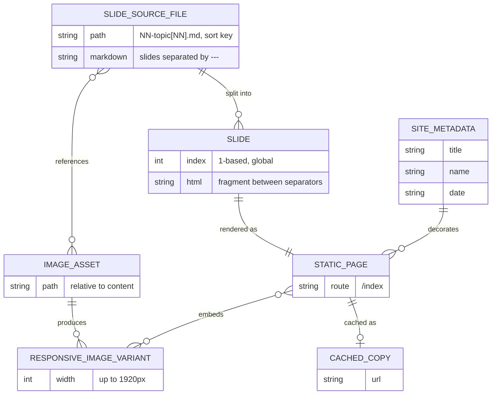
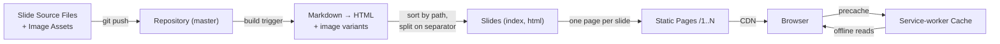

# Information View: System

**Sub-System**: System
**ADRs Referenced**: ADR-001, ADR-002, ADR-005
**Generated**: 2026-10-26
**Dependencies**: Context View, Functional View

---

## 3.3 Information View

**Purpose**: Describe how information is stored, transformed, and flows

The system has **no runtime data store and no user data** (ADR-001). All information is
authored content that is transformed once at build time into immutable static artifacts.

### 3.3.1 Data Entities

| Entity | Storage Location | Owner Component | Lifecycle | Access Pattern |
|--------|------------------|-----------------|-----------|----------------|
| Slide Source File | Version-controlled content directory | Slide Content Store | Authored → edited → committed | Read once per build |
| Image Asset | Version-controlled resources directory | Slide Content Store | Added → committed; rarely changed | Read + resized per build |
| Site Metadata | Build configuration | Page Generator | Set at project setup; rarely changed | Read per build (title, author, date) |
| Slide | Build-time in-memory node graph | Slide Sequencer | Derived each build; discarded after build | Queried by index during page generation |
| Static Page | Hosted static output | Page Generator | Regenerated each deploy; immutable per deploy | Read-only HTTP GET `/N` |
| Responsive Image Variant | Hosted static output | Image Processor | Regenerated each deploy | Read-only HTTP GET |
| Cached Copy | Browser service-worker cache | Offline Cache | Populated on first visit; replaced on worker update | Read-first when offline |

### 3.3.2 Data Model

### 3.3.3 Data Flow

### 3.3.4 Data Quality & Integrity

- **Ordering integrity** depends on file-naming discipline; the build does not validate order
  (ADR-002).
- **Split integrity**: slide boundaries depend on the rendered separator string; malformed
  splits produce no build error (ADR-002).
- **Identity**: slides have no stable IDs; index is positional, so inserting a slide renumbers
  all later routes — accepted trade-off (ADR-002).
- **Freshness**: cached copies may be stale until the service worker updates after a deploy
  (ADR-005).

---

## Perspective Considerations

### Security Considerations

- All information is public; no PII, credentials, or secrets are stored or processed.
- Integrity relies on repository access control: whoever can push to `master` can publish.

_Source ADRs: ADR-001, ADR-004_

### Performance Considerations

- Images are resized at build time so pages ship appropriately sized variants.
- Slide HTML is small (most source files < 500 bytes); no runtime querying.

_Source ADRs: ADR-002, ADR-005_

### Evolution Considerations

- Adding explicit ordering or stable slugs (e.g. frontmatter) would be a data-model change
  touching every source file; currently deferred (ADR-002).

_Source ADRs: ADR-002_

---

## Validation Checklist

- [x] ER diagram in Mermaid `erDiagram`
- [x] Data flow in Mermaid `flowchart`
- [x] Every entity owned by a Functional View element
- [x] Lifecycle stated for each entity

---

**ADR Traceability:**

| ADR | Decision | Impact on Information View |
|-----|----------|----------------------------|
| ADR-001 | Static site, no back end | No runtime store; all data is build-time content |
| ADR-002 | Markdown split, positional index | Defines Slide entity, ordering and identity rules |
| ADR-004 | Netlify builds from master | Repository is the single source of truth |
| ADR-005 | Offline PWA | Adds Cached Copy entity and freshness concern |
