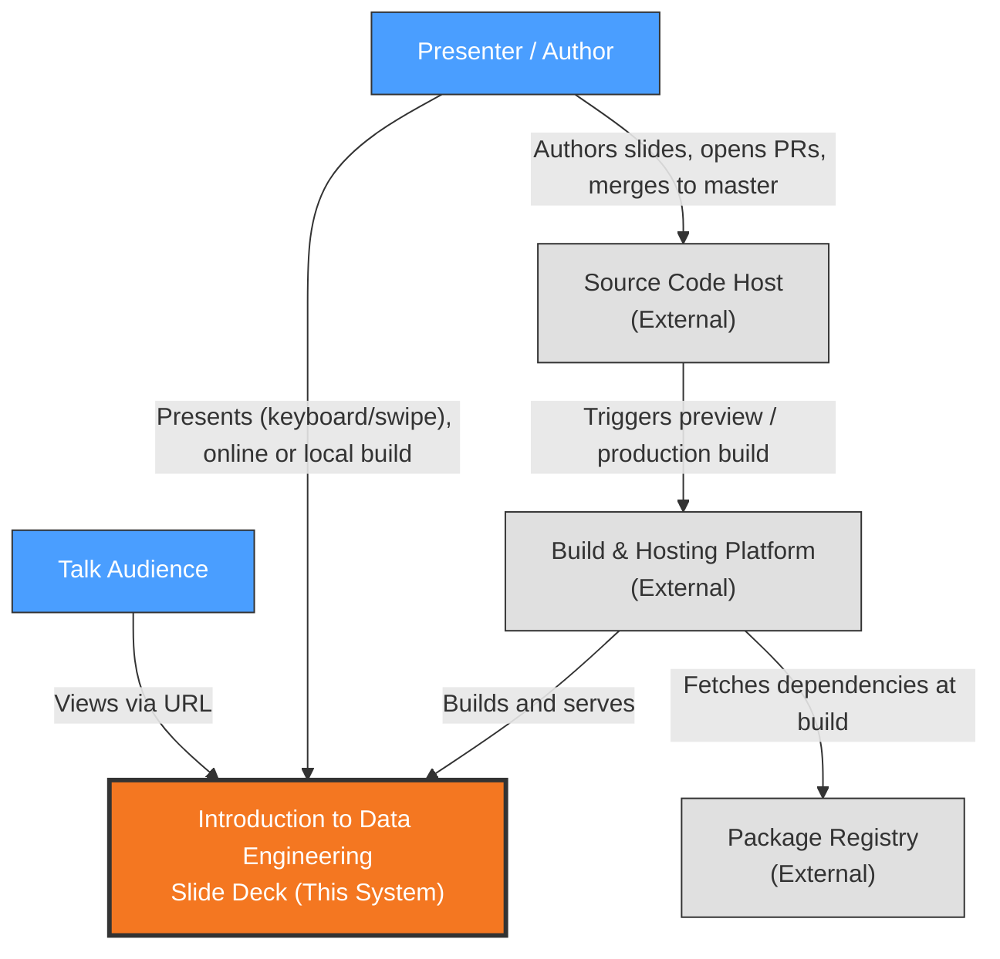
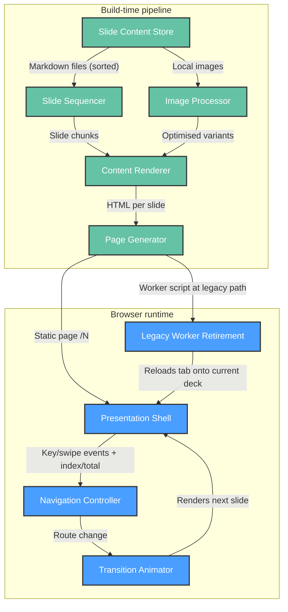
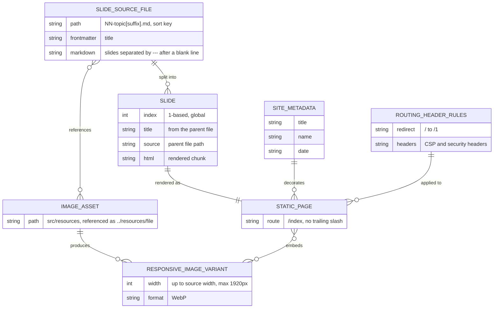
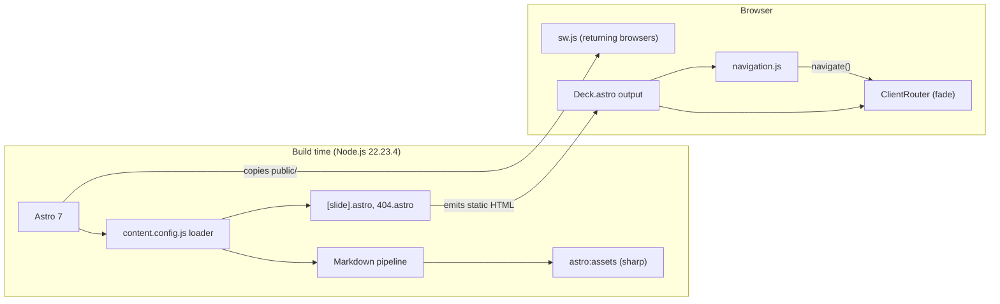
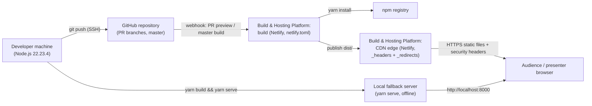

# Architecture Description: Introduction to Data Engineering

## 1. Document Information

| Field | Value |
|-------|-------|
| System | Introduction to Data Engineering — browser-based slide deck |
| Version | 2.0.0 |
| Date | 2026-10-26 |
| Author | Sigal Shaharabani (owner); generated with the Architect extension |
| Status | Current: regenerated after the Gatsby → Astro migration (feature `001-gatsby-to-astro-migration`, PR #131) |
| Method | Rozanski & Woods Viewpoints and Perspectives — core views |
| Scope | Single system, no sub-system decomposition |
| Sources | Accepted ADR-002, ADR-003, ADR-004, ADR-007, ADR-008 (`.specify/memory/adr/`), constitution v2.0.0. Superseded: ADR-001, ADR-005, ADR-006 |

Views 3.4 (Concurrency) and 3.7 (Operational) are not generated: the core view set was selected
and the system has no concurrent runtime processes or operated services of its own.

**Changes from 1.0.0**: Gatsby 5 + React 18 replaced by Astro 7 static output (ADR-007); the
offline service worker replaced by a kill switch and a local-build venue fallback (ADR-008);
Netlify build, header and redirect configuration committed to the repository (ADR-004).

## 2. Architectural Goals & Constraints

**Goals**

- Deliver the talk as a URL-addressable, shareable deck authored in plain Markdown (ADR-002, ADR-007)
- Present reliably live, including without venue network, via a local build (ADR-008)
- Keep the stack small, upgradable and free of known vulnerabilities (ADR-007)

**Constraints** (from `.specify/memory/constitution.md` v2.0.0)

| Constraint | Source |
|------------|--------|
| Slide content MUST be Markdown in `src/slides/`, separated by `---` after a blank line | Constitution §I |
| Slide files MUST follow `NN-topic[suffix].md`; order = sorted path | Constitution §II |
| `yarn build` MUST pass before commit; a green deploy preview is required before merge | Constitution §III |
| Assets MUST live in `src/resources/`; generated widths ≤ 1920px; fonts self-hosted | Constitution §IV |
| New runtime dependencies MUST be justified; no client UI framework without justification | Constitution §V |
| Astro static output; Node.js ≥ 22 (pinned 22.23.4); `yarn.lock` only; Netlify config in `netlify.toml` and `public/_headers`; no service worker | Constitution — Technology & Deployment |

## 3. Architectural Views

### 3.1 Context View

**Purpose**: Define system scope and external interactions

#### 3.1.1 System Scope

"Introduction to Data Engineering" is a browser-based slide deck for a technical talk. It turns
author-written Markdown slides into a statically generated website, built with Astro, that a
presenter navigates live and an audience can open by URL (ADR-002, ADR-007).

In scope: authoring slide content, building the static site, hosting it, and presenting it in
a browser, either from the public URL or from a local build when the venue has no network
(ADR-008). Out of scope: user accounts, data collection, server-side logic, any runtime back
end (ADR-007), and browser-side offline caching (ADR-008).

#### 3.1.2 Stakeholders

| Stakeholder | Role | Key Concerns | Priority |
|-------------|------|--------------|----------|
| Presenter / Author (repository owner) | Writes slides, delivers the talk, maintains the code | Easy Markdown authoring, reliable live navigation, a fallback when the venue network fails | High |
| Talk Audience | Views the deck live or via shared URL | Readable slides, fast loading on any device, touch navigation, shared links that keep working | High |
| Tikal (sponsoring organisation) | Brand shown in footer and metadata | Correct branding, professional presentation | Medium |
| Maintainer (future self / contributors) | Upgrades dependencies, fixes builds | Small upgrade surface, green builds, config in the repo, known security posture | Medium |

**Definition**: Stakeholders are HUMAN actors who interact with or have interest in the system. This includes end users, administrators, operators, and business owners. For automated/external systems, see 3.1.3 External Entities.

#### 3.1.3 External Entities

| Entity | Type | Interaction Type | Data Exchanged | Protocols |
|--------|------|------------------|----------------|-----------|
| Source Code Host (GitHub) | External System | Git push; PRs trigger deploy previews, `master` triggers production builds | Repository contents (Markdown, code, assets, Netlify config) | SSH/HTTPS (git) |
| Build & Hosting Platform (Netlify) | External System | Builds from committed `netlify.toml`, serves via CDN with committed headers and redirects (ADR-004) | Built HTML/JS/CSS/images, response headers | HTTPS |
| Web Browser | External System (user agent) | Renders pages, runs navigation script; no service worker (ADR-008) | Static pages and assets | HTTPS |
| Package Registry (npm) | External System | Build-time dependency download | JavaScript packages (`astro` and dev tooling) | HTTPS |

#### 3.1.4 Context Diagram



#### 3.1.5 External Dependencies

| Dependency | Purpose | SLA Expectations | Fallback Strategy |
|------------|---------|------------------|-------------------|
| Netlify | Build + CDN hosting, headers, redirects (ADR-004) | Provider default; no contract | Local build: `yarn build && yarn serve` on the presenter's laptop (ADR-008); config is in the repo, so re-hosting is possible |
| GitHub | Source of truth, preview and production build trigger | Provider default | Local clone; manual deploy |
| npm registry | Build-time packages | Best effort | `yarn.lock` pins versions; retry build |

---

### Perspective Considerations

#### Security Considerations

- The only trust boundary crossed at runtime is public HTTPS from browser to CDN. Fonts and
  images are self-hosted, so there are no third-party runtime requests. No authentication,
  user data or secrets (ADR-007).
- Content is author-controlled and rendered at build time by the Markdown pipeline (ADR-003).
- Security headers (CSP, Permissions-Policy, nosniff, X-Frame-Options, Referrer-Policy,
  X-XSS-Protection) are committed in `public/_headers` (ADR-004).
- Supply-chain exposure is now small: one runtime dependency (`astro`), pinned by `yarn.lock`
  (ADR-007).

_Source ADRs: ADR-003, ADR-004, ADR-007_

#### Performance Considerations

- Pages are pre-rendered and served from the CDN edge, with no server latency (ADR-004,
  ADR-007).
- Images are optimised WebP with a responsive `srcset`; hashed assets are cached as immutable
  (ADR-007).

_Source ADRs: ADR-004, ADR-007_

#### Evolution Considerations

- Build, header and redirect configuration live in the repo (`netlify.toml`, `public/`), so
  changing hosts means porting committed files (ADR-004).
- Future upgrades track the current Astro major, with the Node pin moving with it (ADR-007).
- `public/sw.js` must stay deployed while old browsers may still hold the Gatsby worker
  (ADR-008).

_Source ADRs: ADR-004, ADR-007, ADR-008_

### 3.2 Functional View

**Purpose**: Describe functional elements, their responsibilities, and interactions

> **Technology Abstraction Rule**: Elements are described by architectural role. Concrete
> technologies are mapped in the Development View (§3.5).

The system is a single deployable static site (ADR-007) with two lifecycle stages: a
**build-time pipeline** that turns Markdown into slide pages, and a **browser runtime** that
presents them. A separate **legacy-worker retirement** element exists only to move browsers
off the previous deployment's offline worker (ADR-008).

#### 3.2.1 Functional Elements

| Element | Stage | Responsibility | Interfaces Provided | Dependencies |
|---------|-------|----------------|---------------------|--------------|
| Slide Content Store | Build | Holds slide source as Markdown files ordered by name; images and fonts in a separate assets directory (ADR-002) | Files in content and assets directories | — |
| Slide Sequencer | Build | Sorts files by path, splits each file's Markdown source at thematic breaks (not after a heading line, not inside code fences), numbers slides globally (ADR-002) | Ordered slide records (index, title, source chunk) | Slide Content Store |
| Content Renderer | Build | Renders each slide chunk to HTML, keeping punctuation as written and code blocks unhighlighted; resolves image references (ADR-007) | HTML per slide | Slide Sequencer, Image Processor |
| Image Processor | Build | Generates optimised responsive image variants, no wider than 1920px (ADR-007) | Optimised image assets | Slide Content Store |
| Page Generator | Build | Emits one static page per slide at `/N` with no trailing slash, plus a NOT FOUND page; declares the `/` → `/1` redirect and response headers (ADR-002, ADR-004) | Static routes `/1..N`, 404, redirect and header rules | Content Renderer |
| Presentation Shell | Runtime | Wraps every slide: document title, footer (logo, deck title, slide number); exposes current index and total to the page (ADR-003) | Layout around current slide | Page Generator output |
| Navigation Controller | Runtime | Maps keys (Right/Enter/Space, Left) and swipes to next/previous slide; bounded at first/last; inactive on the NOT FOUND page (ADR-003) | Client-side route change to `/N±1` | Presentation Shell |
| Transition Animator | Runtime | Cross-fades the slide area for 200 ms on route change; footer swaps without animation (ADR-003) | Animated slide container | Navigation Controller |
| Legacy Worker Retirement | Runtime (returning browsers only) | Clears the previous deployment's offline caches, unregisters its worker, reloads open tabs; nothing registers a worker anymore (ADR-008) | Worker script at the legacy path | Page Generator output (static file) |

#### 3.2.2 Element Interactions



#### 3.2.3 Functional Boundaries

**What this system DOES:**

- Turns ordered Markdown files into numbered, deep-linkable slide pages
- Presents slides with keyboard and touch navigation and fade transitions
- Moves returning browsers off the old offline-cached deck automatically
- Runs fully offline from a local build on the presenter's machine

**What this system does NOT do:**

- No user accounts, authentication, analytics, or data collection
- No server-side logic or runtime API
- No browser-side offline caching of the public URL (ADR-008)
- No presenter tooling: speaker notes, overview grid, presenter/audience split, PDF export
- No stable slugs: slide URLs are positional and shift on insertion (accepted, ADR-002)

---

### Perspective Considerations

#### Security Considerations

- Slide HTML is produced at build time from author-controlled Markdown; there is no runtime
  HTML injection of untrusted content (ADR-003, ADR-007).
- No authorisation model needed: all content is public.
- The retirement worker has no fetch handler, so it cannot intercept requests; it only deletes
  caches and unregisters itself (ADR-008).

_Source ADRs: ADR-003, ADR-007, ADR-008_

#### Performance Considerations

- All transformation cost sits at build time; runtime work is a client-side route change and a
  200 ms fade (ADR-003).
- Images are served as size-appropriate WebP variants (ADR-007).

_Source ADRs: ADR-003, ADR-007_

#### Evolution Considerations

- The Slide Sequencer splits the Markdown source by rule, so it no longer depends on how the
  renderer serialises separators (ADR-002).
- The Navigation Controller reads the current position from the page on each event, so it
  keeps working across client-side page swaps (ADR-003).
- The extension point for new slides is purely additive: add a correctly named file (ADR-002).
- Legacy Worker Retirement is transitional, and can be removed only by a new ADR (ADR-008).

_Source ADRs: ADR-002, ADR-003, ADR-007, ADR-008_

### 3.3 Information View

**Purpose**: Describe how information is stored, transformed, and flows

The system has **no runtime data store and no user data** (ADR-007). All information is
authored content, transformed once at build time into immutable static artifacts. Since
ADR-008 there is no browser-side cache either; the only browser storage the system touches is
the *legacy* Gatsby cache, which it deletes.

#### 3.3.1 Data Entities

| Entity | Storage Location | Owner Component | Lifecycle | Access Pattern |
|--------|------------------|-----------------|-----------|----------------|
| Slide Source File | Version-controlled content directory (`src/slides/`) | Slide Content Store | Authored → edited → committed | Read once per build; re-read live in dev |
| Image Asset | Version-controlled assets directory (`src/resources/`) | Slide Content Store | Added → committed; rarely changed | Read + optimised per build |
| Site Metadata | Build configuration module | Presentation Shell | Set at project setup; rarely changed | Read per build (title, presenter name, date) |
| Slide | Build-time content collection entry | Slide Sequencer | Derived each build; discarded after build | Looked up by index during page generation |
| Static Page | Hosted static output | Page Generator | Regenerated each deploy; immutable per deploy | Read-only HTTP GET `/N` |
| Responsive Image Variant | Hosted static output | Image Processor | Regenerated each deploy; content-hashed name | Read-only HTTP GET, cached as immutable |
| Routing & Header Rules | Version-controlled static files (`public/_redirects`, `public/_headers`) | Page Generator | Changed by commit only | Applied by the CDN to every response |
| Legacy Gatsby Cache | Browser Cache Storage (returning visitors only) | Legacy Worker Retirement | Created by the old deployment; deleted on first visit after migration | Delete-only |

#### 3.3.2 Data Model



#### 3.3.3 Data Flow

```mermaid
flowchart LR
    A["Slide Source Files<br/>+ Image Assets"] -->|"PR / merge"| B["Repository"]
    B -->|"preview or production build"| C["Sort by path,<br/>split source at breaks"]
    C -->|"render each chunk,<br/>optimise images"| D["Slides (index, title, html)"]
    D -->|"one page per slide"| E["Static Pages /1..N<br/>+ 404 + rules"]
    E -->|"CDN with headers"| F["Browser"]
    F -.->|"returning visitors:<br/>delete legacy cache"| G["Legacy Gatsby Cache"]
```



#### 3.3.4 Data Quality & Integrity

- **Ordering integrity** depends on file-naming discipline; the build does not validate order
  (ADR-002).
- **Split integrity**: boundaries follow explicit source rules (a break after a blank line,
  outside code fences); empty chunks are kept so numbering stays stable (ADR-002).
- **Identity**: slides have no stable IDs. The index is positional, so inserting a slide
  renumbers all later routes; this is an accepted trade-off (ADR-002).
- **Freshness**: no browser cache serves stale slides; every visit gets the deployed version
  (ADR-008).
- **Integrity check used in migration**: slide text compared with the previous production
  deck on 40/40 slides (ADR-007).

---

### Perspective Considerations

#### Security Considerations

- All information is public; no PII, credentials or secrets are stored or processed.
- Integrity relies on repository access control: whoever can merge to `master` can publish.
  Deploy previews make changes reviewable before that (ADR-004).

_Source ADRs: ADR-004, ADR-007_

#### Performance Considerations

- Images are optimised at build time, so pages ship WebP variants sized for the viewport
  (ADR-007).
- Slide HTML is small (most source files < 500 bytes); no runtime querying.

_Source ADRs: ADR-002, ADR-007_

#### Evolution Considerations

- Adding explicit ordering or stable slugs (e.g. frontmatter) would be a data-model change
  touching every source file; currently deferred (ADR-002).
- The Legacy Gatsby Cache entity disappears once no returning browser holds it (ADR-008).

_Source ADRs: ADR-002, ADR-008_

### 3.5 Development View

**Purpose**: Describe code organisation, technology mapping, and build process

#### 3.5.1 Code Organization

```text
introduction-to-data-engineering/
├── astro.config.mjs        # URLs (/N, no trailing slash), image + Markdown options, dev redirect
├── netlify.toml            # Build command, publish dir, NODE_VERSION
├── package.json / yarn.lock
├── .tool-versions          # nodejs 22.23.4, yarn 1.22.22
├── .husky/pre-commit       # Runs Prettier on src/**/*.{js,astro} and *.mjs
├── .prettierrc             # + prettier-plugin-astro
├── public/                 # Copied to dist/ unchanged
│   ├── _headers            # CSP + security headers, cache rules
│   ├── _redirects          # / -> /1 (302, forced)
│   └── sw.js               # Legacy Worker Retirement (kill switch)
└── src/
    ├── content.config.js   # Slide Sequencer + Content Renderer (custom loader)
    ├── site.js             # Site Metadata
    ├── slides/             # Slide Content Store: NN-topic[suffix].md (40 files)
    ├── resources/          # Images, logo, self-hosted fonts
    ├── layouts/Deck.astro  # Presentation Shell + Transition Animator wiring
    ├── layouts/index.css   # Deck styling (unchanged from Gatsby, plus image sizing rule)
    ├── scripts/navigation.js  # Navigation Controller
    └── pages/              # [slide].astro (Page Generator), 404.astro
```

#### 3.5.2 Technology Stack Mapping

| Functional Role | Technology Choice | Version/Variant | ADR Reference |
|-----------------|-------------------|-----------------|---------------|
| Static site generator | Astro, static output, no adapter | ^7.4.2 | ADR-007 |
| Slide Content Store + Slide Sequencer | Astro content collection with custom loader (`src/content.config.js`) | — | ADR-002, ADR-007 |
| Content Renderer | Astro Markdown pipeline (`renderMarkdown`), smartypants off, syntax highlighting off | built in | ADR-007 |
| Image Processor | `astro:assets` (sharp), constrained layout, breakpoints ≤ 1920px | built in | ADR-007 |
| Page Generator | `src/pages/[slide].astro` (`getStaticPaths`), `404.astro`, `public/_redirects`, `public/_headers` | — | ADR-002, ADR-004 |
| Presentation Shell | `src/layouts/Deck.astro` | — | ADR-003 |
| Navigation Controller | Plain JavaScript module (`src/scripts/navigation.js`) | — | ADR-003 |
| Transition Animator | `astro:transitions` (`ClientRouter`, `fade` 0.2s) | built in | ADR-003, ADR-007 |
| Legacy Worker Retirement | Static `public/sw.js` | — | ADR-008 |
| Formatting | Prettier + prettier-plugin-astro + Husky | ^3.3.3 / ^1.1.2 / ^9.1.6 | ADR-007 |
| Linting (unconfigured) | ESLint 9, @typescript-eslint 4, babel-eslint 10 | no config file | ADR-007 |
| Runtime | Node.js | 22.23.4 (pinned; Astro 7.4 minimum) | ADR-004, ADR-007 |

#### 3.5.3 Technology Architecture



#### 3.5.4 Module Dependencies

| Module | Depends On | Notes |
|--------|------------|-------|
| `src/content.config.js` | `src/slides/*.md`, Astro loader context (`renderMarkdown`, `store`) | Sorts, splits source at breaks, registers image imports (`assetImports`), live reload in dev |
| `src/pages/[slide].astro` | `slides` collection, `Deck.astro` | One page per entry; passes `index` and `total` |
| `src/layouts/Deck.astro` | `site.js`, `logo.png`, `index.css`, `astro:transitions`, `navigation.js` | Title, footer, `#slide` data attributes, transitions |
| `src/scripts/navigation.js` | `astro:transitions/client` (`navigate`) | Reads index/total from the DOM at event time |
| `src/pages/404.astro` | `Deck.astro` | No index → no footer number, navigation inactive |

#### 3.5.5 Build & CI/CD

| Stage | Where | Command / Mechanism | Gate |
|-------|-------|---------------------|------|
| Format | Local, pre-commit | Husky → `npm run format` (Prettier on `src/**/*.{js,astro}`, `*.mjs`) | Blocks commit on failure |
| Local build check | Local | `yarn build` (Constitution §III) | Required before commit |
| Preview | Local | `yarn develop` (live reload) / `yarn serve` (production build) | Manual visual review |
| Deploy preview | Netlify, on PR | `netlify.toml`: `yarn build`, publish `dist/`, `NODE_VERSION` | Required green before merge (Constitution §III) |
| CI | None in repository | — | — |
| Build + deploy | Netlify, on merge to `master` | Same committed config | Deploy fails if build fails |

#### 3.5.6 Development Standards

- Slide naming and Markdown-first rules: Constitution §I, §II
- Green build before commit, green preview before merge: Constitution §III
- Local optimised assets in `src/resources/`, widths ≤ 1920px: Constitution §IV
- Dependency justification, no client UI framework: Constitution §V
- `yarn.lock` is the only lockfile; `CLAUDE.md` describes the same commands (updated
  2026-10-26)

---

### Perspective Considerations

#### Security Considerations

- Supply chain reduced to one runtime dependency; `yarn audit` reports 0 vulnerabilities
  (2026-10-26). The Gatsby-era transitive security pins are gone (ADR-007).
- No secrets in repository or build; nothing to rotate.

_Source ADRs: ADR-007_

#### Performance Considerations

- Builds take about 2 s locally including image optimisation (41 pages); dev reloads slide
  edits live (ADR-007).

_Source ADRs: ADR-007_

#### Evolution Considerations

- The custom loader depends on Astro's content-loader API; regressions are caught by the slide
  text comparison and the split test (ADR-002, ADR-007).
- Astro majors raise the Node minimum; the pin lives in `.tool-versions`, `netlify.toml` and
  `package.json` (ADR-007).
- The lint toolchain is still installed but non-functional; configure or remove it (ADR-007).
- `public/sw.js` stays until a new ADR retires it (ADR-008).

_Source ADRs: ADR-002, ADR-007, ADR-008_

### 3.6 Deployment View

**Purpose**: Describe the physical environments where the system is built and runs

#### 3.6.1 Runtime Environments

| Environment | Purpose | Infrastructure | Scale |
|-------------|---------|----------------|-------|
| Production | Public deck for talks and sharing | Netlify build + global CDN (site `hardcore-galileo-55838f`), deployed from `master` | Managed static hosting; no instances to size |
| Deploy Previews | Per-PR verification before merge (required by Constitution §III) | Netlify, `deploy-preview-<PR>--hardcore-galileo-55838f.netlify.app`, same committed config | Ephemeral |
| Local Development | Authoring and visual review | Developer machine: `yarn develop` on http://localhost:8000 (live reload) | 1 process |
| Local Production Check | Pre-commit build verification | Developer machine: `yarn build` + `yarn serve` | 1 process |
| Venue Fallback | Presenting without network (ADR-008) | Presenter's laptop: pre-built `dist/` served by `yarn serve` | 1 process + 1 browser |
| Presentation Device | Live delivery | Presenter's browser on the public URL or the local fallback; no service worker | 1 browser |

#### 3.6.2 Network Topology



#### 3.6.3 Hardware Requirements

| Component | CPU | Memory | Storage |
|-----------|-----|--------|---------|
| Build (local or Netlify runner) | Standard runner sufficient; image optimisation is the heaviest step (~2 s total locally) | Node default heap adequate for 40 slides | `node_modules` + `dist/` output (a few MB) |
| Hosting | Managed by Netlify | Managed | Static output only |
| Client | Any modern browser (View Transitions where supported, simulated fallback elsewhere) | Minimal | None used by the deck; returning browsers have their legacy cache deleted |

#### 3.6.4 Third-Party Services

| Service | Purpose | Provider | Tier |
|---------|---------|----------|------|
| Static hosting, CDN, builds, deploy previews | Production site and PR previews | Netlify | Not recorded in repo (account setting) |
| Source hosting, build trigger | Repository `sshahar1/introduction-to-data-engineering` | GitHub | Not recorded |
| Package registry | Build-time dependencies | npm | Public |

---

### Perspective Considerations

#### Security Considerations

- Public, unauthenticated, read-only site over HTTPS; no server-side attack surface.
- Response headers from `public/_headers`: same-origin `Content-Security-Policy` (12
  directives), deny-all `Permissions-Policy`, `X-Content-Type-Options: nosniff`,
  `X-Frame-Options: DENY`, `Referrer-Policy: same-origin`, `X-XSS-Protection`; HSTS added by
  Netlify. Verified identical to the Gatsby production baseline on the PR #131 preview
  (ADR-004).
- Deploy authority = merge access to `master` on GitHub plus Netlify account access; protect
  both (ADR-004).
- The build runner executes npm install scripts; exposure is limited to one runtime
  dependency and the lockfile (ADR-007).

_Source ADRs: ADR-004, ADR-007_

#### Performance Considerations

- Static files from the CDN edge; latency is bound by network, not compute.
- Hashed `/_astro/*` assets are served with `Cache-Control: immutable`; HTML revalidates on
  every visit, so deploys take effect immediately (ADR-004, ADR-008).
- The Quicksand font (400 weight, about 31 KB of woff2) is self-hosted under `/_astro/`
  (ADR-007).

_Source ADRs: ADR-004, ADR-007, ADR-008_

#### Evolution Considerations

- Build settings (command, publish dir, Node version) are committed in `netlify.toml`, so
  re-hosting or recovering the site no longer depends on dashboard state (ADR-004).
- The Node pin must move with Astro's minimum on each major upgrade; the first preview of the
  migration failed exactly on this (ADR-007).
- `/sw.js` is served with `Cache-Control: no-cache` so the kill switch reaches returning
  browsers promptly (ADR-008).

_Source ADRs: ADR-004, ADR-007, ADR-008_

## 4. Architectural Perspectives

### 4.1 Security Perspective

| Concern | Assessment | Views Affected | ADR |
|---------|------------|----------------|-----|
| Authentication / authorisation | None required: public, read-only content | Context, Functional | ADR-007 |
| Data protection | No PII, credentials or secrets stored or processed | Information | ADR-007 |
| Content injection (XSS) | Slide HTML rendered at build time from author-controlled Markdown; no runtime injection. CSP limits scripts, styles, fonts and connections to the site's own origin | Functional, Deployment | ADR-003, ADR-007 |
| Publishing authority | Merge access to `master` + Netlify account = ability to publish; deploy previews make changes reviewable first | Information, Deployment | ADR-004 |
| Supply chain | One runtime dependency (`astro`) pinned by `yarn.lock`; `yarn audit` 0 vulnerabilities (2026-10-26) | Development, Deployment | ADR-007 |
| Transport | HTTPS from CDN; HSTS added by Netlify; no third-party runtime origins | Deployment | ADR-004 |
| HTTP security headers | `public/_headers`: CSP (12 directives, `'unsafe-inline'` for Astro's inlined styles and transition styles), `Permissions-Policy`, `nosniff`, `X-Frame-Options: DENY`, `Referrer-Policy: same-origin`, `X-XSS-Protection`. Verified identical to the Gatsby baseline | Deployment | ADR-004 |
| Legacy service worker | Kill-switch `sw.js` has no fetch handler; it only deletes caches and unregisters | Functional, Information | ADR-008 |

**Threat model (summary)**

| Threat | Likelihood | Impact | Mitigation |
|--------|------------|--------|------------|
| Compromised dependency at build | Low (1 runtime dependency) | Defaced or malicious deck | Lockfile, `yarn audit`, deploy preview review, Netlify build logs |
| Unauthorised merge to `master` | Low | Defaced deck | GitHub account security, branch protection (recommended) |
| Untrusted content added to slides | Low | XSS in viewers | Keep content author-only; CSP blocks third-party scripts; sanitise if that changes |

### 4.2 Performance & Scalability Perspective

Performance targets were explicitly rejected for this small presentation site; this section
records observed behaviour only.

| Aspect | Assessment | ADR |
|--------|------------|-----|
| Response time | Pre-rendered pages from CDN edge; no server compute | ADR-004, ADR-007 |
| Scalability | Scales with CDN; audience size not a constraint | ADR-004 |
| Images | WebP variants with responsive `srcset`, ≤ source width and ≤ 1920px | ADR-007 |
| Caching | Hashed `/_astro/*` assets immutable; HTML revalidates every visit (no service worker) | ADR-004, ADR-008 |
| Critical path | Same-origin self-hosted font (~31 KB woff2, `font-display: swap`); two small module scripts | ADR-007 |
| Build time | ~2 s locally for 41 pages including image optimisation | ADR-007 |

### 4.3 Evolution Perspective

| Change Driver | Current Blocker / Risk | Recommended Direction | ADR |
|---------------|------------------------|-----------------------|-----|
| Astro majors | Raise the Node minimum; loader API could change | Upgrade via Spec Kit; move the Node pin in all three files; re-run text comparison and split test | ADR-007 |
| Slide ordering / identity | Positional URLs shift on insertion | Frontmatter ordering or stable slugs if ever needed (data-model change) | ADR-002 |
| Presenter features | No speaker notes, overview, presenter view, print mode, ARIA | Add as separate features if needed | ADR-003 |
| Lint tooling | ESLint 9 installed, no config, mismatched plugins | Configure flat config or remove packages | ADR-007 |
| Legacy worker | `public/sw.js` must stay while old workers may exist | Remove only by a new ADR | ADR-008 |
| Hosting portability | Resolved: build, header and redirect config committed | — | ADR-004 |

## 5. Architecture Decision Records Summary

Canonical ADRs: [`.specify/memory/adr/index.md`](.specify/memory/adr/index.md) (combined: [`.specify/memory/adr.md`](.specify/memory/adr.md)).

| ID | Decision | Status | Primary Views |
|----|----------|--------|---------------|
| [ADR-001](.specify/memory/adr/ADR-001.md) | Slide deck built as a static-site-generated web app (Gatsby) | Superseded by ADR-007 | — |
| [ADR-002](.specify/memory/adr/ADR-002.md) | Markdown files split into slides, ordered by file path, positional URLs | Accepted (implementation updated) | Functional, Information |
| [ADR-003](.specify/memory/adr/ADR-003.md) | In-house presentation runtime (navigation, transitions) | Accepted (implementation updated) | Functional, Development |
| [ADR-004](.specify/memory/adr/ADR-004.md) | Netlify hosting, platform builds, no repo CI; config now committed | Accepted (implementation updated) | Context, Deployment |
| [ADR-005](.specify/memory/adr/ADR-005.md) | Offline-capable PWA via service worker | Superseded by ADR-008 | — |
| [ADR-006](.specify/memory/adr/ADR-006.md) | Incremental upgrades of the 2020 Gatsby starter | Superseded by ADR-007 | — |
| [ADR-007](.specify/memory/adr/ADR-007.md) | Slide deck built with Astro as a static site | Accepted | Context, Functional, Development, Deployment |
| [ADR-008](.specify/memory/adr/ADR-008.md) | No offline service worker; local-build venue fallback | Accepted | Functional, Information, Deployment |

## 6. Tech Stack Summary

| Layer | Technology |
|-------|------------|
| Content | Markdown (`src/slides/`), images and fonts (`src/resources/`) |
| Site generator | Astro 7.4 static output; custom content loader (`src/content.config.js`); built-in Markdown pipeline and `astro:assets` (sharp) |
| Presentation runtime | `Deck.astro` layout, `astro:transitions` (`ClientRouter`, 200 ms fade), plain-JS `navigation.js`; no UI framework |
| Offline | None; `public/sw.js` retires the legacy Gatsby worker; local `yarn build && yarn serve` fallback |
| Hosting | Netlify static hosting from committed `netlify.toml`, `public/_headers`, `public/_redirects`; source on GitHub |
| Tooling | Node.js 22.23.4, Yarn 1 lockfile, Prettier + prettier-plugin-astro + Husky pre-commit; ESLint 9 (unconfigured) |
