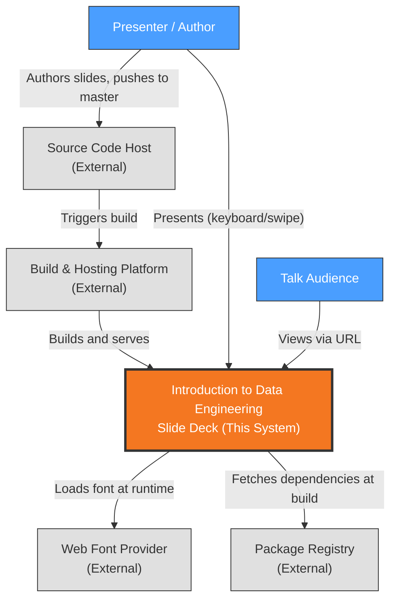
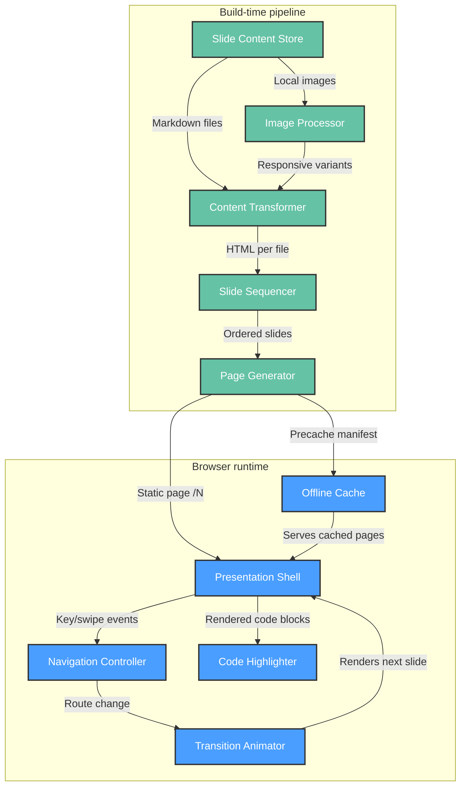
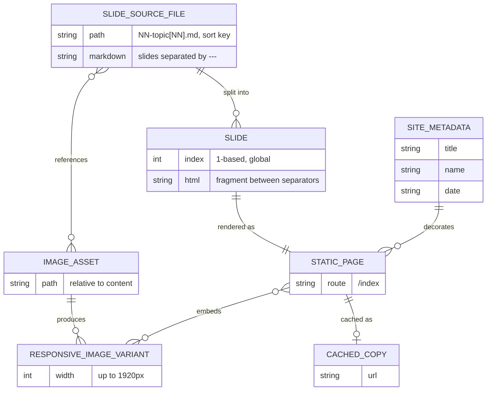
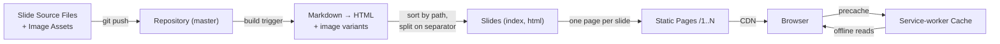
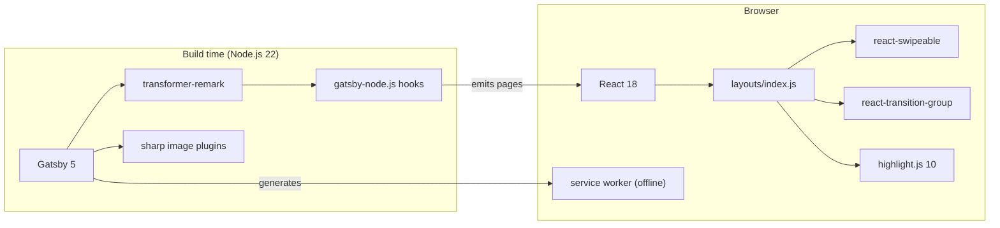
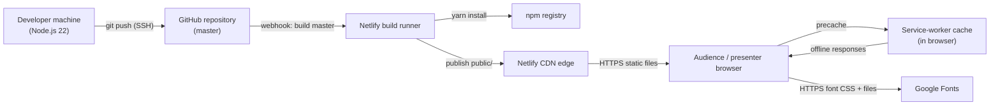

# Architecture Description: Introduction to Data Engineering

## 1. Document Information

| Field | Value |
|-------|-------|
| System | Introduction to Data Engineering — browser-based slide deck |
| Version | 1.0.0 |
| Date | 2026-10-26 |
| Author | Sigal Shaharabani (owner); generated with the Architect extension |
| Status | Baseline (brownfield, reverse-engineered and owner-validated) |
| Method | Rozanski & Woods Viewpoints and Perspectives — core views |
| Scope | Single system, no sub-system decomposition |
| Sources | ADR-001 … ADR-006 (`.specify/memory/adr/`), constitution v1.0.0 |

Views 3.4 (Concurrency) and 3.7 (Operational) are not generated: the core view set was selected
and the system has no concurrent runtime processes or operated services of its own.

## 2. Architectural Goals & Constraints

**Goals**

- Deliver the talk as a URL-addressable, shareable deck authored in plain Markdown (ADR-001, ADR-002)
- Present reliably live, including without venue network (ADR-005)
- Keep the stack upgradable and free of known vulnerabilities with minimal effort (ADR-006)

**Constraints** (from `.specify/memory/constitution.md` v1.0.0)

| Constraint | Source |
|------------|--------|
| Slide content MUST be Markdown in `src/slides/`, separated by `---` | Constitution §I |
| Slide files MUST follow `NN-topic[suffix].md`; order = sorted path | Constitution §II |
| `gatsby build` MUST pass before committing to `master` | Constitution §III |
| Images MUST live in `src/resources/`, max width 1920px | Constitution §IV |
| New runtime dependencies MUST be justified | Constitution §V |
| Node.js >= 22; `yarn.lock` authoritative; Netlify via `gatsby-adapter-netlify` | Constitution — Technology & Deployment |

## 3. Architectural Views

### 3.1 Context View

**Purpose**: Define system scope and external interactions

#### 3.1.1 System Scope

"Introduction to Data Engineering" is a browser-based slide deck for a technical talk. It turns
author-written Markdown slides into a statically generated, offline-capable website that a
presenter navigates live and an audience can open by URL (ADR-001, ADR-002, ADR-005).

In scope: authoring slide content, building the static site, hosting it, and presenting it in
a browser. Out of scope: user accounts, data collection, server-side logic, and any runtime
back end (ADR-001).

#### 3.1.2 Stakeholders

| Stakeholder | Role | Key Concerns | Priority |
|-------------|------|--------------|----------|
| Presenter / Author (repository owner) | Writes slides, delivers the talk, maintains the code | Easy Markdown authoring, reliable live navigation, deck works without venue network | High |
| Talk Audience | Views the deck live or via shared URL | Readable slides, fast loading on any device, touch navigation | High |
| Tikal (sponsoring organisation) | Brand shown in footer and metadata | Correct branding, professional presentation | Medium |
| Maintainer (future self / contributors) | Upgrades dependencies, fixes builds | Upgradable stack, green builds, known security posture | Medium |

**Definition**: Stakeholders are HUMAN actors who interact with or have interest in the system. This includes end users, administrators, operators, and business owners. For automated/external systems, see 3.1.3 External Entities.

#### 3.1.3 External Entities

| Entity | Type | Interaction Type | Data Exchanged | Protocols |
|--------|------|------------------|----------------|-----------|
| Source Code Host (GitHub) | External System | Git push; triggers platform build | Repository contents (Markdown, code, assets) | SSH/HTTPS (git) |
| Static Hosting & Build Platform (Netlify) | External System | Pulls `master`, builds, serves via CDN | Built HTML/JS/CSS/images | HTTPS |
| Web Browser | External System (user agent) | Renders pages, runs service worker | Static pages, cached assets | HTTPS |
| Web Font Provider (Google Fonts) | External System | Browser fetches stylesheet/font at runtime | Quicksand font CSS + font files | HTTPS |
| Package Registry (npm) | External System | Build-time dependency download | JavaScript packages | HTTPS |

#### 3.1.4 Context Diagram



#### 3.1.5 External Dependencies

| Dependency | Purpose | SLA Expectations | Fallback Strategy |
|------------|---------|------------------|-------------------|
| Netlify | Build + CDN hosting (ADR-004) | Provider default; no contract | Service worker serves previously cached deck offline (ADR-005); local `gatsby build` + `gatsby serve` |
| GitHub | Source of truth, build trigger | Provider default | Local clone; manual deploy |
| Google Fonts | Quicksand typeface | Best effort | Browser falls back to system font (not cached offline — ADR-005 follow-up) |
| npm registry | Build-time packages | Best effort | `yarn.lock` pins versions; retry build |

---

#### Perspective Considerations (Context View)

##### Security Considerations

- Only trust boundary crossed at runtime is public HTTPS from browser to CDN and font provider;
  no authentication, no user data, no secrets in the deck (ADR-001).
- Content is author-controlled and built at compile time, which is what makes raw HTML
  injection of slides acceptable (ADR-003).
- Supply-chain exposure is the main risk: build pulls from the npm registry; mitigated by
  lockfile and explicit security pins (ADR-006).

_Source ADRs: ADR-001, ADR-003, ADR-006_

##### Performance Considerations

- Pages are pre-rendered and served from CDN edge; no server latency (ADR-001, ADR-004).
- Third-party font request is the only runtime external call on the critical render path.

_Source ADRs: ADR-001, ADR-004, ADR-005_

##### Evolution Considerations

- Build and hosting configuration lives in the Netlify UI, outside version control; changing
  hosts requires re-creating it (ADR-004).
- Dependency on the Gatsby/npm ecosystem shapes all future upgrades (ADR-006).

_Source ADRs: ADR-004, ADR-006_

_Source: [.specify/architect/views/system/context.md](.specify/architect/views/system/context.md)_

### 3.2 Functional View

**Purpose**: Describe functional elements, their responsibilities, and interactions

> **Technology Abstraction Rule**: Elements are described by architectural role. Concrete
> technologies are mapped in the Development View (§3.5).

The system is a single deployable static site (ADR-001) with two lifecycle stages: a
**build-time pipeline** that turns Markdown into slide pages, and a **browser runtime** that
presents them.

#### 3.2.1 Functional Elements

| Element | Stage | Responsibility | Interfaces Provided | Dependencies |
|---------|-------|----------------|---------------------|--------------|
| Slide Content Store | Build | Holds slide source as ordered Markdown files plus local images (ADR-002) | Files in content directory, ordered by name | — |
| Content Transformer | Build | Parses Markdown to HTML; processes and resizes images | HTML fragments per file | Slide Content Store, Image Processor |
| Image Processor | Build | Generates responsive image variants (max width 1920px) | Optimised image assets | Slide Content Store |
| Slide Sequencer | Build | Sorts files by path, splits HTML on slide separators, numbers slides globally (ADR-002) | Ordered `Slide` records (index, html) | Content Transformer |
| Page Generator | Build | Emits one static page per slide at `/N`; redirects `/` → `/1`; normalises trailing slashes | Static routes `/1..N` | Slide Sequencer |
| Presentation Shell | Runtime | Wraps every slide: title, footer (logo, slide number), branding (ADR-003) | Layout around current slide | Page Generator output |
| Navigation Controller | Runtime | Maps keyboard (←, →, Enter, Space) and swipe gestures to previous/next slide routes; bounds at first/last (ADR-003) | Route change to `/N±1` | Presentation Shell, slide count |
| Transition Animator | Runtime | Fades between slides on route change (200 ms) (ADR-003) | Animated slide container | Navigation Controller |
| Code Highlighter | Runtime | Applies syntax highlighting to code blocks after render (ADR-003) | Styled code blocks | Presentation Shell |
| Offline Cache | Runtime | Service worker precaches pages/assets so the deck runs without network (ADR-005) | Cached responses | Page Generator output |

#### 3.2.2 Element Interactions



#### 3.2.3 Functional Boundaries

**What this system DOES:**

- Turns ordered Markdown files into numbered, deep-linkable slide pages
- Presents slides with keyboard and touch navigation and fade transitions
- Highlights code samples in slides
- Keeps working offline after first visit

**What this system does NOT do:**

- No user accounts, authentication, analytics, or data collection
- No server-side logic or runtime API
- No presenter tooling: speaker notes, overview grid, presenter/audience split, PDF export
- No stable slugs — slide URLs are positional and shift on insertion (accepted, ADR-002)

---

#### Perspective Considerations (Functional View)

##### Security Considerations

- Slide HTML is injected raw into the shell; safe only because the Content Store is
  author-controlled and processed at build time. Accepting external or user content would
  require sanitisation (ADR-003).
- No authorisation model needed: all content is public.

_Source ADRs: ADR-001, ADR-003_

##### Performance Considerations

- All transformation cost sits at build time; runtime work is route change + fade + highlight.
- Code Highlighter re-runs on every render (no memoisation) — negligible at current slide
  sizes, but the one runtime hot path worth fixing (ADR-003).
- Offline Cache makes repeat navigation local after first load (ADR-005).

_Source ADRs: ADR-003, ADR-005_

##### Evolution Considerations

- Slide Sequencer splits on the literal rendered separator string; a change in Markdown
  rendering would silently break slide boundaries (ADR-002).
- Navigation Controller uses a deprecated keyboard API and Code Highlighter relies on an API
  removed in the highlighter's next major version — both block upgrades (ADR-003, ADR-006).
- Extension point for new slides is purely additive: add a correctly named file (ADR-002).

_Source ADRs: ADR-002, ADR-003, ADR-006_

_Source: [.specify/architect/views/system/functional.md](.specify/architect/views/system/functional.md)_

### 3.3 Information View

**Purpose**: Describe how information is stored, transformed, and flows

The system has **no runtime data store and no user data** (ADR-001). All information is
authored content that is transformed once at build time into immutable static artifacts.

#### 3.3.1 Data Entities

| Entity | Storage Location | Owner Component | Lifecycle | Access Pattern |
|--------|------------------|-----------------|-----------|----------------|
| Slide Source File | Version-controlled content directory | Slide Content Store | Authored → edited → committed | Read once per build |
| Image Asset | Version-controlled resources directory | Slide Content Store | Added → committed; rarely changed | Read + resized per build |
| Site Metadata | Build configuration | Page Generator | Set at project setup; rarely changed | Read per build (title, author, date) |
| Slide | Build-time in-memory node graph | Slide Sequencer | Derived each build; discarded after build | Queried by index during page generation |
| Static Page | Hosted static output | Page Generator | Regenerated each deploy; immutable per deploy | Read-only HTTP GET `/N` |
| Responsive Image Variant | Hosted static output | Image Processor | Regenerated each deploy | Read-only HTTP GET |
| Cached Copy | Browser service-worker cache | Offline Cache | Populated on first visit; replaced on worker update | Read-first when offline |

#### 3.3.2 Data Model



#### 3.3.3 Data Flow



#### 3.3.4 Data Quality & Integrity

- **Ordering integrity** depends on file-naming discipline; the build does not validate order
  (ADR-002).
- **Split integrity**: slide boundaries depend on the rendered separator string; malformed
  splits produce no build error (ADR-002).
- **Identity**: slides have no stable IDs; index is positional, so inserting a slide renumbers
  all later routes — accepted trade-off (ADR-002).
- **Freshness**: cached copies may be stale until the service worker updates after a deploy
  (ADR-005).

---

#### Perspective Considerations (Information View)

##### Security Considerations

- All information is public; no PII, credentials, or secrets are stored or processed.
- Integrity relies on repository access control: whoever can push to `master` can publish.

_Source ADRs: ADR-001, ADR-004_

##### Performance Considerations

- Images are resized at build time so pages ship appropriately sized variants.
- Slide HTML is small (most source files < 500 bytes); no runtime querying.

_Source ADRs: ADR-002, ADR-005_

##### Evolution Considerations

- Adding explicit ordering or stable slugs (e.g. frontmatter) would be a data-model change
  touching every source file; currently deferred (ADR-002).

_Source ADRs: ADR-002_

_Source: [.specify/architect/views/system/information.md](.specify/architect/views/system/information.md)_

### 3.5 Development View

**Purpose**: Describe code organisation, technology mapping, and build process

#### 3.5.1 Code Organization

```text
introduction-to-data-engineering/
├── gatsby-config.js        # Plugins, content source, site metadata
├── gatsby-node.js          # Slide Sequencer + Page Generator (build hooks)
├── package.json / yarn.lock
├── .husky/pre-commit       # Runs Prettier on src/**/*.js
├── .prettierrc
└── src/
    ├── slides/             # Slide Content Store: NN-topic[NN].md (~45 files)
    ├── resources/          # Images (logo, diagrams, photos)
    ├── templates/slide.js  # Renders one slide's HTML
    ├── layouts/index.js    # Presentation Shell + Navigation Controller + Code Highlighter
    ├── layouts/index.css   # Deck styling
    ├── components/transition.js  # Transition Animator
    └── pages/              # index.js (redirect / → /1), 404.js
```

#### 3.5.2 Technology Stack Mapping

| Functional Role | Technology Choice | Version/Variant | ADR Reference |
|-----------------|-------------------|-----------------|---------------|
| Static site generator / App shell | Gatsby | ^5.16.1 | ADR-001 |
| UI library | React / React DOM | ^18.1.0 | ADR-001 |
| Slide Content Store source | gatsby-source-filesystem | ^5.12.1 | ADR-002 |
| Content Transformer | gatsby-transformer-remark | 6.16.0 (exact pin) | ADR-002, ADR-006 |
| Image Processor | gatsby-remark-images, gatsby-plugin-sharp, gatsby-transformer-sharp | ^7.12 / ^5.16 | ADR-002 |
| Linked file copy | gatsby-remark-copy-linked-files | ^6.12.0 | ADR-002 |
| Presentation Shell layout | gatsby-plugin-layout, react-helmet | ^4.12 / ^6.1 | ADR-003 |
| Navigation Controller (touch) | react-swipeable | ^6.1.2 | ADR-003 |
| Transition Animator | react-transition-group | ^4.3.0 | ADR-003 |
| Code Highlighter | highlight.js (darcula theme) | ^10.7.3 (held below v11) | ADR-003, ADR-006 |
| Offline Cache | gatsby-plugin-offline | ^6.16.0 | ADR-005 |
| Hosting adapter | gatsby-adapter-netlify | ^1.4.0 | ADR-004 |
| Security pins | tar-fs, cookie, @expo/devcert | ^3.1.1 / ^0.7.2 / ^1.2.1 | ADR-006 |
| Formatting | Prettier + Husky | ^3.3.3 / ^9.1.6 | ADR-006 |
| Linting (unconfigured) | ESLint 9, @typescript-eslint 4, babel-eslint 10 | no config file | ADR-006 |
| Runtime | Node.js | >= 22 | ADR-006 |

#### 3.5.3 Technology Architecture



#### 3.5.4 Module Dependencies

| Module | Depends On | Notes |
|--------|------------|-------|
| `gatsby-node.js` | Remark nodes (GraphQL), `src/templates/slide.js` | Sorts, splits on `<hr>`, creates `Slide` type and pages |
| `src/templates/slide.js` | `Slide` GraphQL type | Injects HTML via `dangerouslySetInnerHTML` |
| `src/layouts/index.js` | `site.siteMetadata`, `allSlide` count, transition, highlight.js, swipeable, logo | Global keydown listener |
| `src/components/transition.js` | react-transition-group | Keyed on `location.pathname` |
| `src/pages/index.js` | Gatsby `navigate` | Redirects to `/1` |

#### 3.5.5 Build & CI/CD

| Stage | Where | Command / Mechanism | Gate |
|-------|-------|---------------------|------|
| Format | Local, pre-commit | Husky → `npm run format` (Prettier on `src/**/*.js`) | Blocks commit on failure |
| Local build check | Local | `gatsby build` (Constitution §III) | Manual, required before commit |
| Preview | Local | `gatsby develop` / `gatsby serve` | Manual visual review |
| CI | None in repository | — | — |
| Build + deploy | Netlify, on push to `master` | `gatsby build`, settings in Netlify UI | Deploy fails if build fails |

#### 3.5.6 Development Standards

- Slide naming and Markdown-first rules: Constitution §I, §II
- Green build before commit: Constitution §III
- Local optimised assets: Constitution §IV
- Dependency justification: Constitution §V
- `yarn.lock` is the authoritative lockfile (Constitution, Technology section); `CLAUDE.md`
  uses the same yarn commands (aligned 2026-10-26)

---

#### Perspective Considerations (Development View)

##### Security Considerations

- Supply chain: transitive vulnerabilities fixed by promoting `tar-fs`, `cookie`,
  `@expo/devcert` to direct dependencies; review on every upgrade (ADR-006).
- No secrets in repository or build; nothing to rotate.

_Source ADRs: ADR-006_

##### Performance Considerations

- Build cost dominated by sharp image processing; acceptable for current asset count.
- `useEffect` without dependency array re-runs highlighting each render (ADR-003).

_Source ADRs: ADR-003_

##### Evolution Considerations

- Upgrade blockers: highlight.js v11 (`initHighlighting` removed), deprecated `keyCode`
  (ADR-003); exact remark pin (ADR-006).
- Lint toolchain is installed but non-functional (no `eslint.config.*`, plugin majors mismatch
  ESLint 9) — either configure or remove (ADR-006).
- Build config not in repo; committing `netlify.toml` would make builds reproducible (ADR-004).

_Source ADRs: ADR-003, ADR-004, ADR-006_

_Source: [.specify/architect/views/system/development.md](.specify/architect/views/system/development.md)_

### 3.6 Deployment View

**Purpose**: Describe the physical environments where the system is built and runs

#### 3.6.1 Runtime Environments

| Environment | Purpose | Infrastructure | Scale |
|-------------|---------|----------------|-------|
| Production | Public deck for talks and sharing | Netlify build + global CDN (site `hardcore-galileo-55838f`), deployed from `master` | Managed static hosting; no instances to size |
| Deploy Previews | Optional per-branch/PR preview | Netlify (platform feature, if enabled in UI) | Ephemeral |
| Local Development | Authoring and visual review | Developer machine: `gatsby develop` on http://localhost:8000 | 1 process |
| Local Production Check | Pre-commit build verification | Developer machine: `gatsby build` + `gatsby serve` | 1 process |
| Presentation Device | Live delivery | Presenter's browser, possibly offline via service-worker cache | 1 browser |

#### 3.6.2 Network Topology



#### 3.6.3 Hardware Requirements

| Component | CPU | Memory | Storage |
|-----------|-----|--------|---------|
| Build (local or Netlify runner) | Standard runner sufficient; sharp image processing is the heaviest step | Node default heap adequate for ~45 slides | `node_modules` + `public/` output (tens of MB) |
| Hosting | Managed by Netlify | Managed | Static output only |
| Client | Any modern browser | Minimal | Service-worker cache for pages + images |

#### 3.6.4 Third-Party Services

| Service | Purpose | Provider | Tier |
|---------|---------|----------|------|
| Static hosting, CDN, builds | Production site | Netlify | Not recorded in repo (UI setting) |
| Source hosting, build trigger | Repository `sshahar1/introduction-to-data-engineering` | GitHub | Not recorded |
| Web fonts | Quicksand typeface | Google Fonts | Free |
| Package registry | Build-time dependencies | npm | Public |

---

#### Perspective Considerations (Deployment View)

##### Security Considerations

- Public, unauthenticated, read-only site over HTTPS; no server-side attack surface.
- Deploy authority = push access to `master` on GitHub plus Netlify account access; protect
  both (ADR-004).
- Build runner executes npm install scripts — supply-chain exposure addressed by lockfile and
  security pins (ADR-006).

_Source ADRs: ADR-004, ADR-006_

##### Performance Considerations

- Static files from CDN edge; latency bound by network, not compute.
- Repeat and offline visits served from service-worker cache (ADR-005).
- Google Fonts is a cross-origin request on first paint; self-hosting would remove it.

_Source ADRs: ADR-001, ADR-005_

##### Evolution Considerations

- Build settings (Node version, command, publish dir) live only in the Netlify UI; moving
  hosts or recovering a lost site requires re-creating them. A committed `netlify.toml` would
  capture them (ADR-004).
- `engines.node >= 22` must match the Netlify runner's Node version on each upgrade (ADR-006).

_Source ADRs: ADR-004, ADR-006_

_Source: [.specify/architect/views/system/deployment.md](.specify/architect/views/system/deployment.md)_

## 4. Architectural Perspectives

### 4.1 Security Perspective

| Concern | Assessment | Views Affected | ADR |
|---------|------------|----------------|-----|
| Authentication / authorisation | None required — public, read-only content | Context, Functional | ADR-001 |
| Data protection | No PII, credentials, or secrets stored or processed | Information | ADR-001 |
| Content injection (XSS) | Slide HTML injected raw; acceptable only because content is author-controlled and built at compile time | Functional | ADR-003 |
| Publishing authority | Push access to `master` + Netlify account = ability to publish | Information, Deployment | ADR-004 |
| Supply chain | Build installs npm packages; mitigated by `yarn.lock` and direct security pins (`tar-fs`, `cookie`, `@expo/devcert`) | Development, Deployment | ADR-006 |
| Transport | HTTPS from CDN and font provider | Deployment | ADR-004 |

**Threat model (summary)**

| Threat | Likelihood | Impact | Mitigation |
|--------|------------|--------|------------|
| Compromised dependency at build | Medium | Defaced or malicious deck | Lockfile, pin review on upgrade, Netlify build logs |
| Unauthorised push to `master` | Low | Defaced deck | GitHub account security, branch protection (recommended) |
| Untrusted content added to slides | Low | XSS in viewers | Keep content author-only; sanitise if that changes |

### 4.2 Performance & Scalability Perspective

| Aspect | Assessment | ADR |
|--------|------------|-----|
| Response time | Pre-rendered pages from CDN edge; no server compute | ADR-001, ADR-004 |
| Scalability | Scales with CDN; audience size not a constraint | ADR-004 |
| Repeat/offline loads | Served from service-worker cache | ADR-005 |
| Critical path | Cross-origin Google Fonts request on first paint | ADR-005 |
| Runtime hot path | Code highlighting re-runs every render (no dependency array) | ADR-003 |
| Build time | Dominated by sharp image processing; acceptable at ~45 slides | ADR-002 |

### 4.3 Evolution Perspective

| Change Driver | Current Blocker / Risk | Recommended Direction | ADR |
|---------------|------------------------|-----------------------|-----|
| highlight.js v11 | `initHighlighting()` removed | Switch to `highlightAll()` or build-time highlighting | ADR-003, ADR-006 |
| Keyboard API | `keyCode` deprecated | Use `KeyboardEvent.key` | ADR-003 |
| Markdown renderer changes | Split on literal `<hr>` may silently fail | Split on Markdown AST `thematicBreak` | ADR-002 |
| Gatsby / Node upgrades | Exact `gatsby-transformer-remark` pin; Netlify Node version must match `engines` | Re-test pin each upgrade; commit `netlify.toml` | ADR-004, ADR-006 |
| Lint tooling | ESLint 9 installed, no config, mismatched plugins | Configure flat config or remove packages | ADR-006 |
| Hosting portability | Build settings only in Netlify UI | Commit `netlify.toml` | ADR-004 |
| Ecosystem momentum | Gatsby plugin maintenance uncertain | Periodically reassess vs. slide frameworks | ADR-001, ADR-006 |

## 5. Architecture Decision Records Summary

Canonical ADRs: [`.specify/memory/adr/index.md`](.specify/memory/adr/index.md) (combined: [`.specify/memory/adr.md`](.specify/memory/adr.md)).

| ID | Decision | Status | Primary Views |
|----|----------|--------|---------------|
| [ADR-001](.specify/memory/adr/ADR-001.md) | Slide deck built as a static-site-generated web app (Gatsby) | Accepted | Context, Functional, Development |
| [ADR-002](.specify/memory/adr/ADR-002.md) | Markdown files split on `<hr>`, ordered by file path, positional URLs | Accepted | Functional, Information |
| [ADR-003](.specify/memory/adr/ADR-003.md) | In-house presentation runtime (navigation, transitions, highlighting) | Accepted | Functional, Development |
| [ADR-004](.specify/memory/adr/ADR-004.md) | Netlify hosting from `master`, settings in UI, no repo CI | Accepted | Context, Deployment |
| [ADR-005](.specify/memory/adr/ADR-005.md) | Offline-capable PWA via service worker (deliberate) | Accepted | Functional, Information, Deployment |
| [ADR-006](.specify/memory/adr/ADR-006.md) | Incremental upgrades of the 2020 starter; security pins | Accepted | Development, Deployment |

## 6. Tech Stack Summary

| Layer | Technology |
|-------|------------|
| Content | Markdown (`src/slides/`), local images (`src/resources/`) |
| Site generator | Gatsby 5 (`gatsby-source-filesystem`, `gatsby-transformer-remark` 6.16.0, sharp plugins) |
| UI | React 18, `react-helmet`, `gatsby-plugin-layout` |
| Presentation runtime | `react-swipeable`, `react-transition-group`, `highlight.js` 10 |
| Offline | `gatsby-plugin-offline` |
| Hosting | Netlify (`gatsby-adapter-netlify`), source on GitHub |
| Tooling | Node.js >= 22, Yarn lockfile, Prettier + Husky pre-commit; ESLint 9 (unconfigured) |
